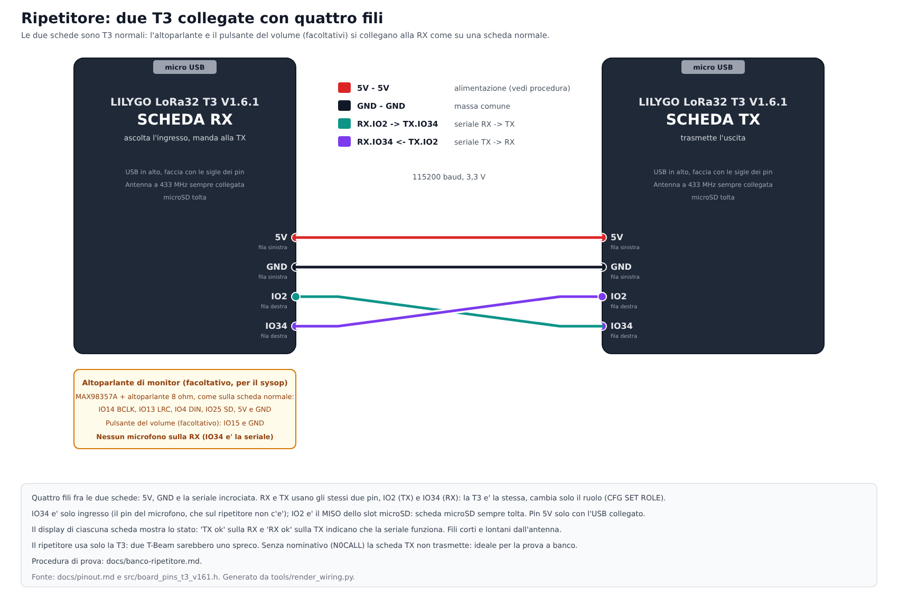

# Prova a banco del ripetitore (due T3)

12/11/2026. Prima prova delle due T3 collegate fra loro: **cablaggio, seriale e display**. Il ripetitore è solo logica provata sul PC: questa è la prima volta sulle schede. Le fasi 1-3 **non trasmettono in aria** (con il nominativo N0CALL la scheda TX non trasmette mai); la fase 4 è facoltativa e usa una terza scheda a potenza minima.

## Cosa serve
- Due T3 V1.6.1 con l'ultimo firmware (`firmware-t3-v161` da Actions o dal sito, [versioni.md](versioni.md)), antenne a 433 MHz **collegate** (anche con N0CALL: regola di sempre).
- Fili corti con terminali da ponticello: tre per la prima prova (GND e le due della seriale), il quarto (5V) dopo, vedi fase 1. **microSD tolta** da entrambe.
- Un cavo USB per volta, per configurare le schede (sito di configurazione o terminale a 115200, [firmware.md](firmware.md)).
- Facoltativo: un altoparlante con MAX98357A (fase 3), una terza T3 con un nominativo vero (fase 4).

## Fase 0: preparare le due schede (una alla volta, con il cavo USB)
Il nominativo resta **N0CALL** (valore di fabbrica) su entrambe: così la TX non trasmette.

| Scheda RX | Scheda TX |
|---|---|
| `CFG SET FREQ 433.900` | `CFG SET FREQ 433.900` |
| `CFG SET ROLE RPTRX` | `CFG SET ROLE RPTTX` |
| | `CFG SET FREQOUT 434.400` |
| `CFG REBOOT` | `CFG REBOOT` |

(Dalla pagina di configurazione: *Ruolo della scheda* e *Frequenza di uscita*; vedi [firmware.md](firmware.md).) Con un ruolo da ripetitore la scheda non ha più il menu a bordo: per tornare normale `CFG SET ROLE OFF` e `CFG REBOOT` dal cavo USB.

**Attesi sulla seriale USB al riavvio** (terminale a 115200):
- RX: `[ripetitore] ruolo rptrx (antenna collegata?)`, poi `[ripetitore] RX: ingresso 433.900 MHz, profilo Standard, modo ripetuto 1 e testo`.
- TX: `[ripetitore] ruolo rpttx ...`, poi `[ripetitore] TX: uscita 434.400 MHz, profilo Standard, nominativo N0CALL (N0CALL: non trasmette)`.

Sul display, per 1,5 s: "RIPETITORE / scheda RX" (o TX).

## Fase 1: i quattro fili e la seriale
**Spegni tutto, poi** collega fra le due schede (schema in alto): GND-GND, **RX.IO2 → TX.IO34** e **TX.IO2 → RX.IO34** (la seriale è incrociata).

**Alimentazione, la parte che non ho potuto verificare:** lo schema della T3 dice solo che il pin `5V` del connettore esce quando c'è l'USB; non so se accetta anche un ingresso, né se due 5V collegati fra loro con due USB diversi creino problemi. **Per la prima prova usa tre fili** (GND e le due della seriale) con **un cavo USB per scheda** e **lascia scollegato il filo dei 5V**. Il filo dei 5V, con un solo alimentatore, si aggiunge dopo, quando hai controllato lo schema dell'alimentazione (o con un multimetro sul pin 5V) e mi dici com'è andata.

| Cosa guardare | Atteso | Se no |
|---|---|---|
| Display RX, ultima riga | `TX ok coda 0` entro 2-3 s | `TX NON RISPONDE`: fili IO2/IO34 invertiti, filo staccato, masse non comuni |
| Display TX, ultima riga | `N0CALL no TX, RX ok` | `... RX NO`: stessa lista; controlla anche che la TX sia davvero in ruolo `rpttx` |
| Display RX, riga 1-2 | `RIPETITORE  RX`, `In 433.900 MHz std` | frequenza o ruolo sbagliati: `CFG GET` |
| Display TX, riga 1-2 | `RIPETITORE  TX`, `Out 434.400 MHz std` | idem |
| Riga 3 e 4 | RX `Ric 0  Rip 0`, `Scarti 0  Altri 0`; TX `Voce 0  Coda 0`, `Persi 0  da RX 0` | numeri che salgono da soli: rumore sulla seriale, fili lunghi |

**Prova di interruzione:** scollega un filo della seriale: dopo circa **3,5 s** la scheda che non sente più l'altra scrive `NON RISPONDE` (RX) o `RX NO` (TX); ricollegando torna `ok` entro 1-2 s. Questo prova che il controllo del collegamento funziona nei due sensi.

**Prova del reset:** premi RST su una scheda alla volta: l'altra segnala la perdita e poi il ritorno del collegamento senza bisogno di toccarla.

## Fase 2: configurazione dal cavo USB mentre il ripetitore lavora
Con le due schede collegate e funzionanti, collega il cavo USB a una scheda e chiedi `CFG GET`: deve rispondere con `role=rptrx` (o `rpttx`) e le frequenze impostate, e la seriale fra le schede **non deve perdere il collegamento** (display `ok`). Poi `CFG SET IDINT 1` sulla TX, `CFG GET IDINT` deve rispondere `CFG IDINT=1` (non serve riavviare per questa prova).

## Fase 3 (facoltativa): altoparlante di monitor sulla RX
1. Collega MAX98357A e altoparlante **come su una scheda normale** (schema [collegamenti-t3.png](images/collegamenti-t3.png): IO14 BCLK, IO13 LRC, IO4 DIN, IO25 SD, 5V e GND), con il pulsante del volume su IO15 se lo vuoi. **Nessun microfono.**
2. Sulla RX: `CFG SET MONITOR ON`, `CFG REBOOT`.
3. Atteso: all'avvio "MONITOR / altoparlante"; sul display RX la riga 4 diventa `Scarti 0  Vol 5/10` (il volume parte da `CFG SET VOLUME`); la seriale fra le schede continua a dire `TX ok` (era il punto del cambio di pin). Il pulsante volume sposta il volume e fa un bip.
4. **Se la seriale cade quando accendi il monitor** o l'altoparlante soffia sempre: lo schema dei pin ha un conflitto: segnalalo (quale pin, quale scheda).

## Fase 4 (facoltativa, in aria a potenza minima): un pacchetto vero attraverso il ripetitore
Serve una **terza T3 normale** con un nominativo vero, `CFG SET POWER 2` (la potenza minima), frequenza 433.900 e **l'antenna sempre collegata** (una scheda LoRa non va mai fatta trasmettere senza antenna). Si prova a un paio di metri, con le antenne di tutte e tre le schede collegate. Il ripetitore ha ancora N0CALL: **non ritrasmette**, scarta.
1. Premi PTT sulla terza scheda per 2-3 s.
2. Atteso sulla RX: riga 3 `Ric` sale di qualche unità e `Rip` con lei (un pacchetto valido del progetto è inoltrato alla TX); riga 1 `RIPETITORE  RX` (con il monitor `RX <nominativo>` mentre si parla).
3. Atteso sulla TX: riga 4 `da RX n` (il numero che ricorda la RX) e riga 3 `Voce 0  Coda 0` (la TX scarta senza trasmettere).
4. Con il monitor acceso la voce si sente dall'altoparlante.

## Cosa mandarmi
Per ogni fase che hai fatto: una foto dei due display (o le righe lette), l'esito `ok` o `NON RISPONDE`, e le righe della seriale USB dell'avvio (due righe per scheda). Se qualcosa non va, dimmi **quale pin e quale scheda**: i pin sono in `src/board_pins_t3_v161.h` (`kLinkRx`, `kLinkTx`) e si cambiano in un minuto.

## Dopo la prova
`CFG SET ROLE OFF` e `CFG REBOOT` su ogni scheda per tornare stazioni normali. Il primo test **in aria** con un nominativo vero (identificativo periodico, risposte del sysop, ritrasmissione dei messaggi) è un passo successivo e si fa con carico fittizio e potenza minima.
