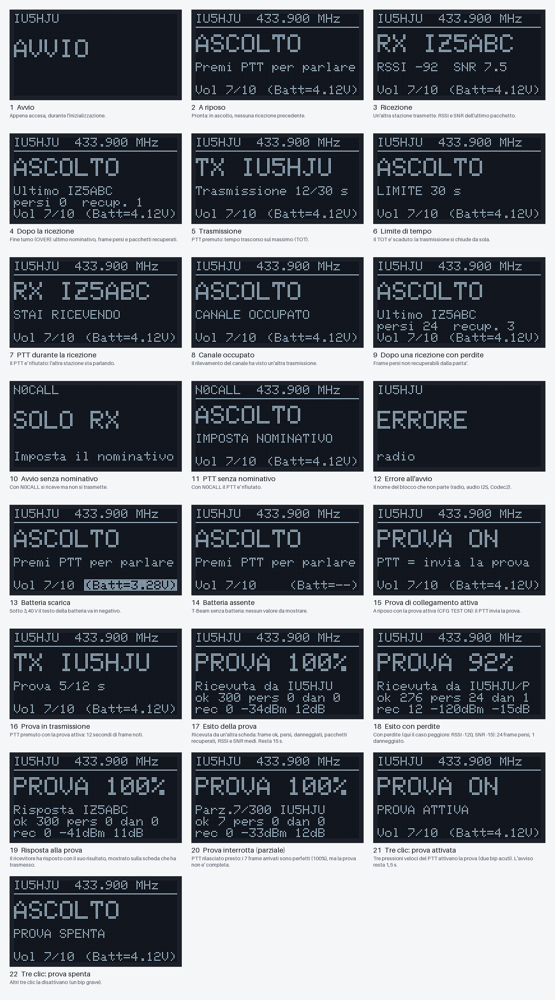

# Display OLED



Il display è l'SSD1306 128×64 della T3 V1.6.1. L'immagine **non è una foto**: è un mockup generato da
`tools/render_display.py` con lo stesso font 5×7 di Adafruit_GFX, le stesse coordinate e lo stesso ritorno a capo
automatico del codice in `src/ui.cpp`. Sul display reale i colori dipendono dal pannello (di solito bianco o azzurro).

## Novità del 10/11/2026

- **Lettera del profilo:** in alto a destra, su ogni schermata, una lettera grande (bianca su nero, 10×9 punti) indica il profilo in uso: **S** Standard, **M** Messaggio, **Q** Qualità. La riga del nominativo è stata accorciata (`IU5HJU 433.900MHz`) per farle posto.
- **Menu a bordo:** quattro voci (Standard, Messaggio, Qualità, Wi-Fi; dall'11/11 cinque, con "Invia testo"), una per riga; la scelta in negativo e il profilo in uso con `*`.
- **Schermata Wi-Fi** (voce "Wi-Fi" del menu): in alto il nome della rete `LoRaCodec2-XXXX`, poi `Password:` e la **password in carattere doppio e in grassetto** (8 cifre), in basso `http://192.168.4.1` e `VOL lungo = esci`. Con questa schermata la scheda non trasmette e non riceve.
- **Messaggi (11/11/2026):** a ricezione conclusa compare una **grande icona** (altoparlante = voce, busta = testo), "MESSAGGIO RICEVUTO" e "Premi PTT: ascolta" (o "leggi"); il PTT breve apre il messaggio. Il testo si legge a pagine di 6 righe (volume breve = pagina successiva). Il menu ha ora **cinque voci** (Standard, Messaggio, Qualità, **Invia testo**, Wi-Fi), senza titolo; "Invia testo" apre la scelta dei testi ("INVIA TESTO 2/5", "PTT=altro VOL=invia"). Dettagli in [modo-messaggio.md](modo-messaggio.md).
- **Messaggio:** durante l'invio e la ricezione compare la percentuale (1-100%) con una barra di avanzamento.
- Le immagini in `images/display.png` sono i mockup della prima versione e **non** mostrano ancora queste novità.

## Struttura di una schermata

```
IU5HJU  433.900 MHz          riga 1: nominativo e frequenza (testo piccolo)
------------------------     linea di separazione
ASCOLTO                      riga 2: stato (testo grande)
Premi PTT per parlare        riga 3: informazioni o avvisi (testo piccolo)
Vol 7/10   (Batt=4.12V)       ultima riga: volume a sinistra, batteria a destra
```

## Schermate

| # | Quando compare | Cosa mostra |
|---|---|---|
| 1 | Avvio | "AVVIO" |
| 2 | A riposo, dopo l'avvio | "ASCOLTO", frequenza, "Premi PTT per parlare" |
| 3 | Un'altra stazione trasmette | "RX" e nominativo, **RSSI** (dBm) e **SNR** (dB) dell'ultimo pacchetto |
| 4 | Dopo una ricezione | "Ultimo" e nominativo, frame **persi** e pacchetti **recuperati** dalla parità |
| 5 | PTT premuto | "TX" e nominativo, secondi trascorsi sul massimo ("Trasmissione 12/30 s") |
| 6 | TOT scaduto | Avviso "LIMITE 30 s" |
| 7 | PTT premuto durante una ricezione | Avviso "STAI RICEVENDO" |
| 8 | PTT con canale occupato | Avviso "CANALE OCCUPATO" |
| 9 | Dopo una ricezione con perdite | Come la 4, con "persi" diversi da zero |
| 10 | Avvio con N0CALL | "SOLO RX" e "Imposta il nominativo" |
| 11 | PTT con N0CALL | Avviso "IMPOSTA NOMINATIVO" |
| 12 | Errore all'avvio | "ERRORE" e il nome del blocco: `radio`, `audio I2S`, `Codec2`, `nominativo non valido` |
| 13 | Batteria sotto 3,40 V | il testo `(Batt=x.xxV)` va in negativo (sfondo pieno) |
| 14 | Batteria assente (T-Beam senza cella) | `(Batt=--)` (sulla T3 la tensione si mostra sempre) |
| 15 | A riposo con la prova di collegamento attiva | "PROVA ON", "PTT = invia la prova" |
| 16 | PTT premuto con la prova attiva | "TX" e nominativo, "Prova 5/12 s" |
| 17 | Fine di una prova ricevuta | "PROVA 100%", "Ricevuta da" e nominativo, frame ok/persi/danneggiati, pacchetti recuperati, RSSI e SNR medi. Resta 15 s |
| 18 | Come la 17 ma con perdite | percentuale più bassa; le righe stanno nei 21 caratteri anche nel caso peggiore (RSSI -120 dBm, SNR -15 dB) |
| 19 | Risposta alla prova trasmessa da qui | come la 17 con "Risposta" e il nominativo dell'altra stazione |
| 21 | Tre clic veloci sul PTT: prova attivata | avviso "PROVA ATTIVA" (1,5 s), due bip acuti |
| 22 | Altri tre clic: prova spenta | avviso "PROVA SPENTA", un bip grave |
| 23 | Nominativo di 8 caratteri (per esempio `IU5HJU/P`) | "TX IU5HJU/P" o "RX IU5HJU/P": la riga grande passa al testo piccolo, perché a testo grande entrano solo 10 caratteri |
| 24 | "Suona i toni" della pagina | "PROVA TONI" e "fase 1: senza radio" per circa 4 secondi |
| 26 | "Registra e poi trasmetti" (registrazione) | "REGISTRA" e "Registro 3/30 s" |
| 27 | Dopo il rilascio del PTT | "ATTESA" e "Parte tra 1 secondo" |
| 28 | La scheda trasmette il messaggio | "INVIO" e "Trasmetto messaggio" |
| 25 | Fase 2 della prova audio (toni con la radio in trasmissione) | "PROVA TONI" e "fase 2: con radio TX" |
| 20 | Prova interrotta o incompleta | come la 17, ma la riga sotto la percentuale dice "Parz.7/300" e il nominativo: la percentuale è sui frame arrivati, non su 300 |

Gli avvisi 6, 7, 8 e 11 restano a schermo circa 1,5-2 secondi; l'esito della prova (17-19) 15 secondi, senza volume e batteria. Due bip acuti a prova perfetta, un bip grave se ci sono state perdite. Ogni trasmissione e ricezione termina anche con un bip.

## Batteria (in basso a destra)

Formato `(Batt=4.12V)`, come nel firmware LoRa APRS iGate di Guzman. Larghezza fissa di 12 caratteri (72 pixel): non tocca "Vol" a sinistra, nemmeno con "Vol 10/10".

| Scheda | Come si misura |
|---|---|
| **T-Beam V1.2** | dal chip AXP2101 (tensione della batteria, come fa Guzman). Se la batteria non c'è mostra `(Batt=--)`. Letta ogni 2 secondi. |
| **LoRa32 T3 V1.6.1** | ADC su GPIO35 con partitore 100k/100k (tensione letta × 2), con la calibrazione del chip, mediata su 16 letture raccolte senza fermare il programma (Guzman ne fa 20 con una pausa di 3 ms l'una). |

- Sotto **3,40 V** il testo va in negativo per segnalare batteria scarica.
- Il valore a schermo cambia solo se la misura si sposta di almeno 0,03 V (oppure ogni 10 secondi), per non ridisegnare di continuo il display.
- **Sulla T3 la tensione è sempre mostrata**, mai lineette. Senza batteria e con USB la misura è quella della linea del caricatore (misurati 4,14-4,42 V, oscilla), non della batteria né dei 5 V dell'USB: per non far ballare le cifre la lettura è mediata con una costante di tempo di circa 2,5 s e il valore mostrato resta in una banda di pochi centesimi di volt. Il testo va in negativo sotto 3,40 V, come sulla T-Beam.
- Anche la seriale stampa la tensione ogni 10 secondi (`[pmu] ...` sulla T-Beam, `[batteria] x.xx V` sulla T3).

## Note

- Il "12" di "Prova 5/12 s" è la durata fissa della prova (300 frame).
- Il "30" di "Trasmissione 12/30 s" e di "LIMITE 30 s" oggi è fisso. Quando il TOT diventerà un'impostazione
  (vedi [roadmap](roadmap.md)) seguirà il valore scelto.
- A testo grande (12 pixel per carattere) entrano **10 caratteri** sui 128 pixel: le righe grandi più lunghe passano al testo piccolo. `tools/render_display.py` segnala e rifiuta ogni testo che andrebbe a capo.
- Se l'OLED non risponde il sistema funziona comunque, con bip e riga seriale.
- Per rigenerare l'immagine dopo una modifica a `src/ui.cpp`: aggiorna le funzioni di `tools/render_display.py` e lancia
  `python3 tools/render_display.py PERCORSO/glcdfont.c docs/images/display.png`. Il file `glcdfont.c` è nel
  repository `adafruit/Adafruit-GFX-Library`. Serve Pillow.
