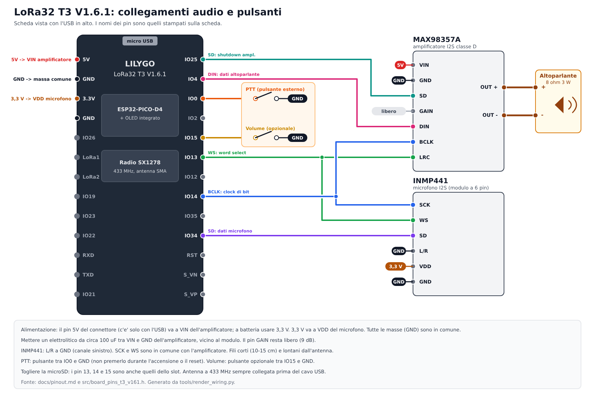
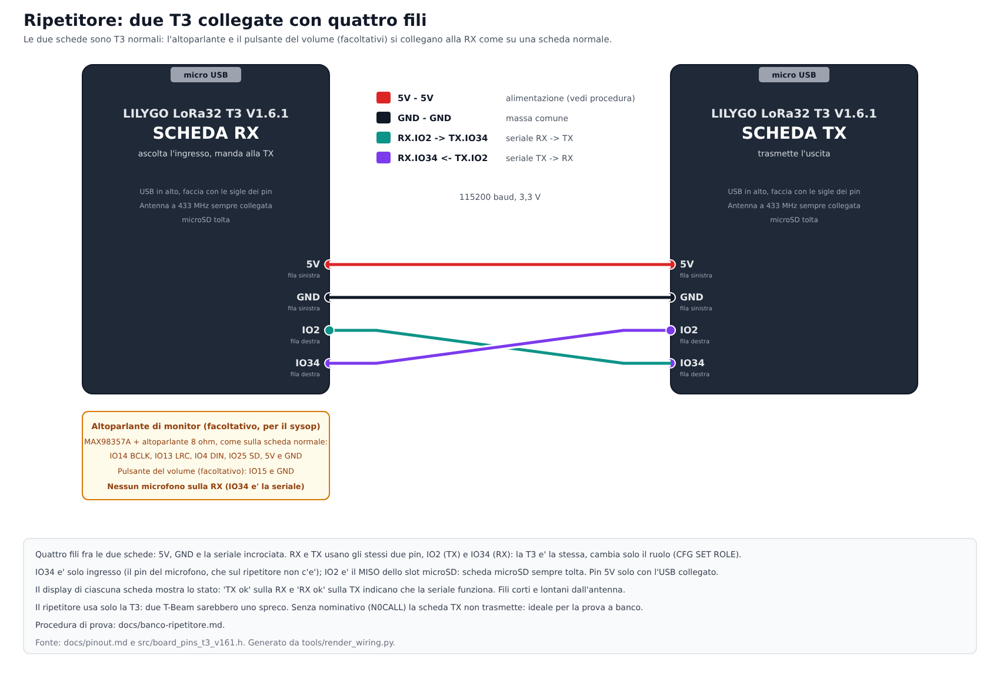
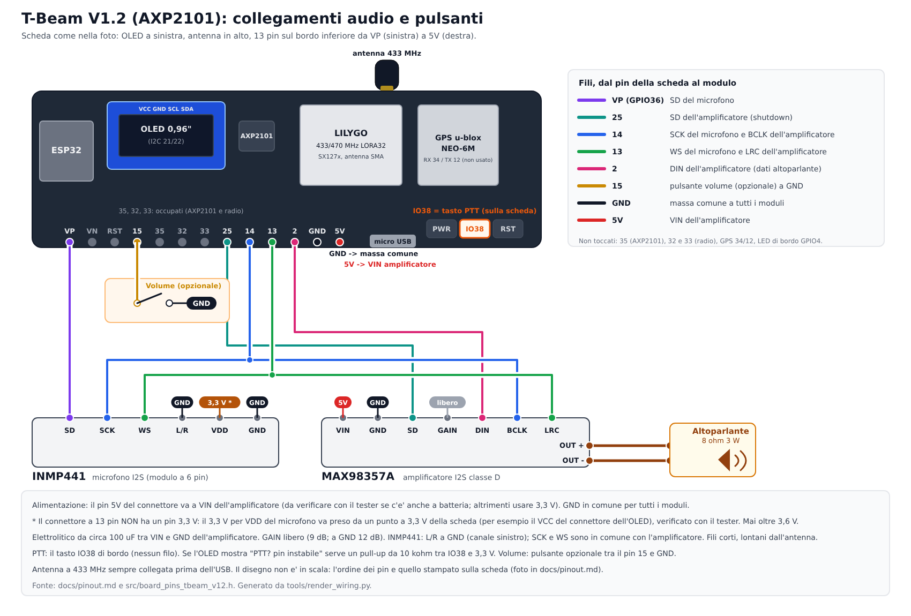

# Pinout

Le schede supportate sono due. La mappa in codice è un file per scheda, scelto a compilazione
(`-DBOARD_T3_V161` o `-DBOARD_TBEAM_V12`) e controllato da `tests/test_pins.cpp`:

| Scheda | Ambiente | File dei pin | Stato |
|---|---|---|---|
| LILYGO LoRa32 T3 V1.6.1 | `lora32` | [`src/board_pins_t3_v161.h`](../src/board_pins_t3_v161.h) | provata (avvio, OLED, PTT, trasmissione) |
| LILYGO T-Beam V1.2 (AXP2101) | `tbeam` | [`src/board_pins_tbeam_v12.h`](../src/board_pins_tbeam_v12.h) | **provata:** avvio, AXP2101, radio, tasto IO38, GPS e voce (4-10 novembre) |

La sezione seguente riguarda la **T3**; quella della T-Beam è più sotto.

## LILYGO LoRa32 T3 V1.6.1

Scheda confermata dalla foto: serigrafia **T3_V1.6.1**, modulo LoRa 433/470 MHz, **ESP32-PICO-D4**
(4 MB di flash, senza PSRAM), USB micro con CH9102, connettore batteria LiPo, SMA più connettore U.FL.

## Schema dei collegamenti (T3)

**Orientamento:** lo schema mostra la **faccia dei componenti** (modulo LoRa e chip ESP32) con l'USB in alto: è la faccia dove sono stampate le sigle dei pin, e l'OLED sta sull'altra faccia. Colonna sinistra dall'alto: `5V, GND, 3.3V, GND, IO26, LoRa1, LoRa2, IO19, IO23, IO22, RXD, TXD, IO21`; colonna destra: `IO25, IO4, IO0, IO2, IO15, IO13, IO12, IO14, IO35, IO34, RST, S_VN, S_VP` (verificato su foto della scheda e sullo schema elettrico LilyGO). Girando la scheda dal lato dell'OLED le due colonne si scambiano di posto.

Versione vettoriale: [collegamenti-t3.svg](images/collegamenti-t3.svg), generata da `tools/render_wiring.py`.
I fili dello stesso colore vanno insieme; le etichette scure (GND), rossa (5V) e arancio (3,3 V) indicano i pin di alimentazione.

## Componenti (ordinati il 2 novembre 2026)

| Funzione | Modello |
|---|---|
| Microfono | INMP441 (modulo rotondo a 6 pin), 3 pezzi |
| Amplificatore | MAX98357A I2S classe D, 3 pezzi |
| Altoparlante | 3 W / 8 Ω con cavetto, 4 pezzi |
| Schede | 2 × LILYGO LoRa32 T3 V1.6.1, 433 MHz |

## Pin già usati dalla scheda

Fonte: documentazione e `utilities.h` del repository ufficiale Xinyuan-LilyGO/LilyGo-LoRa-Series.

| Funzione | GPIO |
|---|---|
| Radio SX1278: SCK / MISO / MOSI / CS | 5 / 19 / 27 / 18 |
| Radio: RST / DIO0 / DIO1 / DIO2 | 23 / 26 / 33 / 32 |
| OLED SSD1306: SDA / SCL | 21 / 22 |
| microSD: CS / MOSI / MISO / SCK | 13 / 15 / 2 / 14 |
| LED utente | 25 |
| ADC batteria | 35 |

La scheda non ha un pulsante utente: c'è solo **RST**.

## Assegnazione per il progetto

| Segnale | GPIO | Collegamento |
|---|---|---|
| I2S BCLK (condiviso) | 14 | INMP441 `SCK` e MAX98357A `BCLK` |
| I2S WS (condiviso) | 13 | INMP441 `WS` e MAX98357A `LRC` |
| Dati microfono | 34 | INMP441 `SD` (GPIO34 è solo ingresso, va bene) |
| Dati altoparlante | 4 | MAX98357A `DIN` |
| Shutdown amplificatore | 25 | MAX98357A `SD` (alto = acceso); è anche il LED di bordo |
| PTT | 0 | Pulsante esterno tra GPIO0 e GND (pull-up interno) |
| Volume (opzionale) | 15 | Pulsante esterno tra GPIO15 e GND; se non collegato non fa nulla |

Collegamenti fissi:

- INMP441: `VDD` a 3,3 V, `GND` a massa, `L/R` a **GND**.
- MAX98357A: `GND` a massa, `VIN` a 5 V (USB) o, a batteria, a 3,3 V; `GAIN` libero.

Perché così:

- **Microfono e amplificatore condividono BCLK e WS:** con una sola porta I2S in full duplex servono 4 pin invece di 6. Entrambi lavorano a **16 kHz** con slot da 32 bit, quindi l'uscita va impostata con `upsample2x = true`. Il microfono resta sempre acceso (pre-roll) anche mentre l'altoparlante suona, quindi serve il full duplex.
- **GPIO13 e GPIO14 sono i pin dello slot microSD:** funzionano solo senza scheda inserita. La documentazione LilyGO avverte inoltre di togliere la microSD quando si carica il firmware.
- **GPIO0 per il PTT:** è anche il pin di boot, quindi il pulsante esterno funziona da PTT e permette di forzare la modalità flash. Non tenerlo premuto durante accensione o reset.
- **GPIO12, 1, 3, 6-11 evitati:** strapping, UART di debug e flash.
- Restano liberi: GPIO2 (strapping, ma utilizzabile), GPIO35 (ADC batteria), GPIO22/21 se l'OLED non serve.

## Ripetitore: due T3 collegate fra loro (12/11/2026)

Il ripetitore unisce **due T3** già cablate come stazioni normali (microfono non necessario sulla RX; altoparlante di monitor facoltativo, pulsante volume invariato) con **quattro fili**: 5V, GND e la seriale incrociata. La seriale usa due pin che il cablaggio normale non tocca:

| Segnale | GPIO | Collegamento |
|---|---|---|
| Seriale RX | 34 | TX (IO2) dell'altra scheda (GPIO34 è solo ingresso: va bene, è il pin del microfono che qui non c'è) |
| Seriale TX | 2 | RX (IO34) dell'altra scheda (MISO dello slot microSD: lasciarlo vuoto) |

Due T-Beam sarebbero uno spreco (GPS, PMU e batteria non servono a un ripetitore fisso): il ripetitore è solo T3. 

Dettagli in [firmware.md](firmware.md) e [studio-ripetitore.md](studio-ripetitore.md); prova a banco in [banco-ripetitore.md](banco-ripetitore.md). **Da verificare sul banco.**

## Alimentazione

- Il pin `5V` del connettore dà i 5 V solo con USB collegato. Con batteria l'amplificatore va a 3,3 V (circa 0,7 W su 8 Ω); il 3,3 V è condiviso con ESP32 e radio, quindi un condensatore da circa 100 µF vicino all'amplificatore è utile.
- Questa versione non ha un circuito di protezione della batteria: usare una LiPo con protezione.
- Il LED `CHG` indica la carica.

## Antenna

Collegare sempre l'antenna a 433 MHz **prima** di alimentare o trasmettere: senza carico il modulo radio si può danneggiare. Nella foto l'antenna è collegata al connettore SMA.

## Da verificare con le schede in mano

- Che GPIO13/14 siano davvero liberi (microSD non inserita) e che il cablaggio non carichi i segnali.
- L'OLED (SSD1306 128x64, indirizzo 0x3C, GPIO21/22) è presente sulla scheda; il firmware lo usa per lo stato e per il nominativo ricevuto. Se non risponde il sistema funziona comunque, con i segnali acustici.
- Il livello I2S dell'amplificatore (possibile dimezzamento con la media dei canali).

## LILYGO T-Beam V1.2 (AXP2101)

**Display OLED esterno (per esempio una T-Beam senza OLED di bordo):** si collega ai pin **IO21 (SDA)** e **IO22 (SCL)**, più `3V3` e `GND`: sono gli stessi dell'OLED di bordo e dell'AXP2101, quindi il firmware `tbeam` va bene così. Il firmware cerca il display a **0x3C** e poi a **0x3D** e, all'avvio, scrive sulla seriale i dispositivi I2C trovati (`[avvio] dispositivi I2C trovati: 0x34 0x3C`: 0x34 è l'AXP2101). Il driver è per controller **SSD1306 128x64**; un display da 1,3" con controller SH1106 funziona ma può apparire spostato di 2 pixel o con la prima colonna sporca.

**Fase 1: supporto scritto, compilato e provato sulla scheda (4-5 novembre 2026):** avvio anche a batteria, AXP2101, radio, tasto IO38 come PTT, trasmissione e ricezione con la T3 (SNR circa 11-12 dB a 1-2 m). Dal 5 al 10 novembre: GPS con fix (4 satelliti) e trasmissione di voce tra T3 e T-Beam nei tre profili ([prove.md](prove.md)).
Scheda riconosciuta dalla serigrafia **T-BEAM-AXP2101-V1.2** (8 maggio 2023): ESP32 con 4 MB di flash (e 8 MB di PSRAM, non usata),
modulo LoRa "LORA32 433/470MHz" (famiglia SX127x come la T3; il primo avvio lo conferma, RadioLib controlla il chip),
GPS u-blox NEO-6M, **OLED** SSD1306 montato, tasti PWR / IO38 / RST, pila a bottone per il GPS, vano per la batteria 18650.

### Differenze rispetto alla T3

| Aspetto | T3 V1.6.1 | T-Beam V1.2 |
|---|---|---|
| Alimentazione | diretta | **AXP2101** (I2C 0x34) che alimenta radio (ALDO2) e GPS (ALDO3): va inizializzato prima della radio |
| Radio | SX127x, stessi pin | SX127x, **stessi pin** (SCK 5, MISO 19, MOSI 27, CS 18, DIO0 26, RST 23, DIO1 33) |
| OLED | integrato | montato sul connettore, stesso bus I2C 21/22 |
| PTT | pulsante esterno IO0-GND | **tasto di bordo IO38** (solo ingresso, senza pull-up interno) |
| GPS | assente | RX = GPIO34 (dal GPS), TX = GPIO12 (verso il GPS, non usato: al GPS non si scrive); alimentazione ALDO3 a 3,3 V, spenta di default, accesa con `CFG SET GPS ON` ([firmware.md](firmware.md)) |
| LED di bordo | GPIO25 | GPIO4 (attivo basso) |

### Assegnazione per il progetto

| Segnale | GPIO | Collegamento |
|---|---|---|
| I2S BCLK (condiviso) | 14 | INMP441 `SCK` e MAX98357A `BCLK` |
| I2S WS (condiviso) | 13 | INMP441 `WS` e MAX98357A `LRC` |
| Dati microfono | **36** (pin `VP`) | INMP441 `SD` (solo ingresso, va bene). Non il 34: è il GPS |
| Dati altoparlante | **2** | MAX98357A `DIN`. Non il 4: è il LED di bordo |
| Shutdown amplificatore | 25 | MAX98357A `SD` (alto = acceso) |
| PTT | **38** | tasto di bordo `IO38` |
| Volume (opzionale) | 15 | pulsante esterno tra GPIO15 e GND |

Sul connettore della scheda i pin accessibili sono `VP(36)`, `VN(39)`, 15, 35, 32, 33, 25, 14, 13, 2, GND, 5V.
**Non utilizzabili:** 32 e 33 (DIO della radio) e 35 (interrupt dell'AXP2101).
Il collegamento fisso del microfono (`VDD` a 3,3 V, `GND`, `L/R` a GND) e dell'amplificatore (`VIN`, `GND`, `GAIN` libero) è lo stesso della T3.

### Schema dei collegamenti (T-Beam)

**Orientamento:** lo schema mostra la scheda come si tiene in mano e come si legge la serigrafia: OLED a sinistra, antenna in alto, i **13 pin sul bordo inferiore da `VP` (a sinistra) a `5V` (a destra)** e il micro USB con i tre tasti a destra dei pin. Il disegno non è in scala, ma l'ordine dei pin è quello stampato sulla scheda. Versione vettoriale: [collegamenti-tbeam.svg](images/collegamenti-tbeam.svg), generata da `tools/render_wiring.py tbeam`. Il connettore a 13 pin non ha un pin 3,3 V: per `VDD` del microfono prendere i 3,3 V da un punto della scheda (per esempio il VCC del connettore dell'OLED) e verificarli con il tester.

### Da verificare con la scheda in mano

- **Il tasto IO38** ha un pull-up esterno sulla scheda? GPIO38 non ne ha di interni. Il firmware controlla all'avvio che il pin sia stabile: se cambia livello da solo, il PTT viene **disattivato** e l'OLED mostra "PTT? pin instabile". In quel caso serve una resistenza di pull-up (10 kΩ verso 3,3 V).
- **Il chip radio** è davvero un SX127x (se fosse SX1262 compare "ERRORE radio"; serve allora una variante del codice).
- **La batteria:** all'avvio la seriale stampa `[pmu] AXP2101 ok, batteria presente/assente, … mV, … %, USB …, carica …`.
- **Alimentazione dell'amplificatore** dal pin 5V del connettore o dalla batteria: stesse regole della T3.
