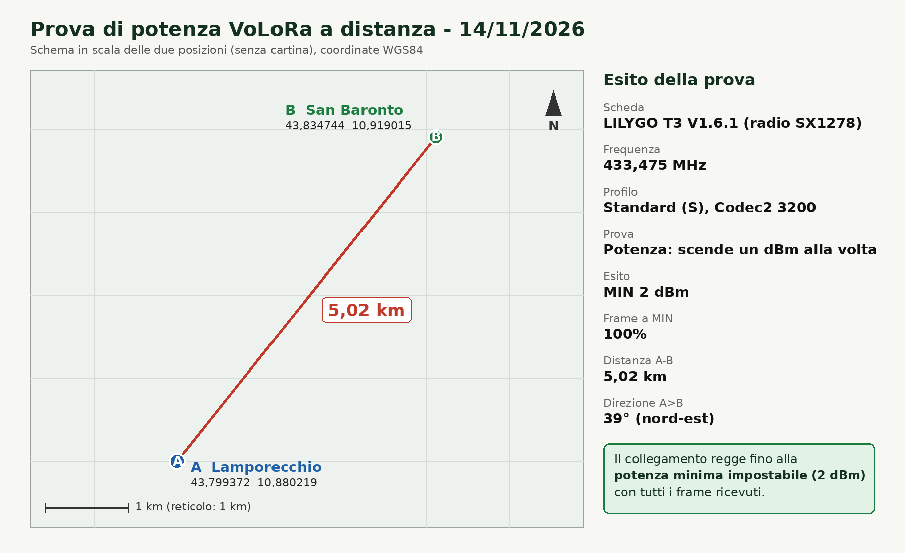
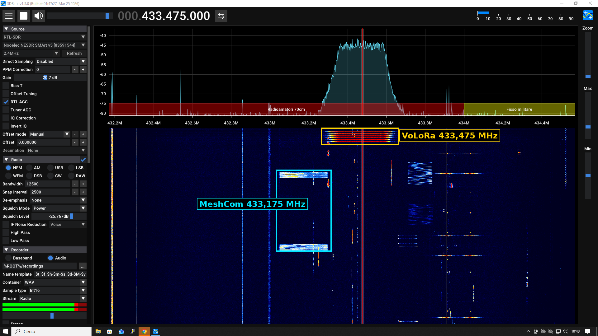

# Registro delle prove

> **Nota del 12/11/2026 sui nomi dei profili.** Questo documento è stato scritto con i nomi di allora: *Standard* (Codec2 1200, SF8), *Messaggio* e *Qualità* (Codec2 3200, SF7). Da quel giorno si chiamano **Range** (1200, SF8, lettera R), **Messaggio** (M) e **Standard** (3200, SF7, lettera S). Le parti storiche non sono state riscritte.

Qui si annotano le prove fatte sulle schede, da chiunque partecipi, in modo che i risultati restino
nel repository. Una prova per sezione, in ordine cronologico, la più recente in fondo.
Per un problema da risolvere apri invece una segnalazione (Issues) e collega la prova.

> **Prima di ogni prova:** antenna a 433 MHz collegata a entrambe le schede **prima** del cavo USB,
> microSD tolta, PTT non premuto all'accensione. Trasmetti solo con il tuo nominativo, su una frequenza
> e con una potenza consentite. Procedura di caricamento in [firmware.md](firmware.md).

## Quanto annotare per ogni prova

| Voce | Esempio |
|---|---|
| Data e luogo | 03/11/2026, casa |
| Chi | IU5HJU |
| Versione del firmware | commit `0466536`, artefatto di Actions o pagina web, ramo `main` |
| Schede | 2 × LoRa32 T3 V1.6.1 |
| Collegato | solo radio / microfono / altoparlante / tutto |
| Frequenza e parametri | 433,900 MHz, SF8, BW250, CR 4/5, 10 dBm, parità on |
| TOT | 30 s |
| Antenne | stilo originale, SMA |
| Distanza e ambiente | 5 m, stessa stanza |
| Risultato | cosa si è visto e sentito |
| Problemi | messaggi dell'OLED, righe della seriale |

## Scaletta consigliata

Ogni livello presuppone che il precedente funzioni.

1. **Avvio.** L'OLED mostra "AVVIO" e poi "ASCOLTO" con nominativo e frequenza. Con N0CALL mostra "SOLO RX".
2. **Solo radio.** Premi il PTT su una scheda (anche senza microfono): l'altra passa a "RX" con il nominativo, l'**RSSI** (dBm) e l'**SNR** (dB) dell'ultimo pacchetto ricevuto. Per un esito certo usa la [prova di collegamento](prova-collegamento.md) (`CFG TEST ON` su entrambe).
3. **Microfono.** Parla con il PTT premuto: sull'altra scheda deve arrivare audio (anche con l'altoparlante non ancora collegato non si rompe nulla; si guardano le statistiche "persi" e "recup." a fine ricezione).
4. **Altoparlante.** Controlla volume, bip di fine trasmissione e di fine ricezione, assenza di fruscio a riposo.
5. **Voce a turni.** Turno di qualche secondo, attesa di 5-10 s, risposta. Qualità e comprensibilità.
6. **Portata.** Allontana le schede a passi, annotando distanza, RSSI, SNR e comprensibilità. Con SF8 il pacchetto si demodula fino a circa -10 dB di SNR (valore teorico): più ci si avvicina a quel limite, più i frame persi aumentano.

## Aiuto per la diagnosi

- Seriale della scheda: `pio device monitor` a 115200 baud, oppure un qualunque terminale seriale.
  A fine di ogni ricezione stampa una riga pronta per il registro, per esempio
  `RX fine: IU5HJU RSSI -92 dBm SNR 7.5 dB, frame persi 0, pacchetti recuperati 1`.
- **Perdite a distanza ravvicinata:** a fine ricezione la seriale stampa anche `[rx] pacchetti letti N, errori CRC N, sovrascritti N, ritardo massimo di lettura N ms`. "Sovrascritti" conta i pacchetti arrivati prima di aver letto il precedente (il FIFO della radio contiene un solo pacchetto): se è maggiore di zero la scheda ricevente è troppo lenta tra un pacchetto e l'altro. "Errori CRC" conta i pacchetti arrivati danneggiati.
- **Voce debole o "gracchiante" (radio a posto, `frame persi 0`):** la riga `[mic] ... uscita al codec X dBFS` della scheda che trasmette dice il livello che va al codec (con la voce deve stare vicino a -24 dBFS, il target dell'AGC); a fine ricezione la scheda che riceve stampa `[rx-audio] N frame: decodificato rms X dBFS (max Y), uscita rms Z dBFS (max W), guadagno AGC A...B dB, limitatore su N frame, volume V dB`. Il parlato decodificato di una voce normale sta tra -40 e -20 dBFS; con il volume a 0 dB l'uscita segue l'AGC di riproduzione (target -24 dBFS). Un decodificato molto basso (sotto -50) indica che il codec ha ricevuto poco segnale (microfono, fondo troppo alto, AGC); un decodificato normale ma un'uscita bassa o un limitatore sempre attivo punta alla riproduzione (volume, AGC di uscita, amplificatore).
- **Riavvio continuo con `A stack overflow in task loopTask has been detected` sulla seriale:** lo stack del task principale è troppo piccolo. Corretto portandolo a 32 kB (3 novembre 2026); se ricompare, indica il punto in cui si ferma con le righe `[avvio]`.
- **"ERRORE" sull'OLED:** il nome indica il blocco (Codec2, audio I2S, radio); il codice è nella seriale.
- **Livello del microfono:** con il PTT premuto la seriale stampa due volte al secondo `[mic] livello -38 dBFS, picco -25 dBFS, offset 0.4%, AGC in -45 dBFS, guadagno 12 dB, errori 0`. Parlando vicino al microfono il picco deve salire a circa -30...-6 dBFS; sotto -80 è silenzio (cavi o `LCR_MIC_SLOT`), oltre -3 è saturazione. Un offset continuo molto alto (decine di %) indica un collegamento errato. **"AGC in"** è il livello che l'AGC vede (dopo il passa-alto): se in silenzio sta sopra la soglia il fondo del microfono (soglia dell'AGC = fondo + 6 dB, standard fondo -60 dBFS: si misura dalla pagina di configurazione) il guadagno sale al massimo e il fondo viene amplificato come voce. Il fondo si misura con "Misura il fondo" nella pagina di configurazione; il guadagno massimo è `LCR_MIC_AGC_MAX_GAIN_DB`.
- **Si sente solo silenzio:** prova `LCR_MIC_SLOT 1` in `src/user_config.h`.
- **Volume dimezzato o basso:** verifica il pin `SD` dell'amplificatore e l'alimentazione (5 V o 3,3 V).
- **"CANALE OCCUPATO" a canale libero:** il rilevamento del canale ha rilevato attività; annota quando e dove.
- **"STAI RICEVENDO":** la scheda sta ancora riproducendo una trasmissione; è normale per qualche secondo.

## Registro

### Modello da copiare

```
### GG/MM/AAAA, luogo, chi
- Firmware: (commit o artefatto)
- Schede e collegamenti:
- Parametri radio (frequenza, SF, BW, CR, potenza, parità, TOT):
- Antenne:
- Distanza e ambiente:
- Livello raggiunto della scaletta (1-6):
- Risultato (cosa si vede e si sente, RSSI, SNR, "persi" e "recup."):
- Problemi (OLED, seriale):
- Da fare / idee:
```

### Prove effettuate

> **Nota sul ramo `prova-iu5hju`.** Le prove fino al 5 novembre 2026 citano il ramo `prova-iu5hju`: era `main` con il nominativo dell'autore compilato nel firmware. Dal 5 novembre il nominativo si imposta dalla pagina web e il ramo, come `tbeam-fase1`, è stato eliminato: la sola differenza con `main` era quella riga. Le voci seguenti restano com'erano scritte.

### 03/11/2026, casa, IU5HJU (prova con una sola scheda)

- Firmware: ramo `prova-iu5hju`, prima versione (avvio bloccato) e poi commit `4e8395a` (con stack a 32 kB).
- Schede e collegamenti: **una** LoRa32 T3 V1.6.1, antenna a 433 MHz, OLED integrato. Nessun microfono, amplificatore o altoparlante collegato. PTT simulato con un filo tra IO0 e GND.
- Parametri radio: 433,900 MHz (segnaposto), SF8, BW250, CR 4/5, 10 dBm, parità on, TOT 30 s.
- Livello raggiunto della scaletta: **1 (avvio)** completato, **2 (solo radio)** a metà: la trasmissione parte, la ricezione non è ancora verificata perché manca la seconda scheda.
- Risultato:
  - versione iniziale: la scheda restava su "AVVIO" e si riavviava in continuo; la seriale mostrava `A stack overflow in task loopTask has been detected`. Causa: stack del task principale di 8 kB, insufficiente per Codec2. **Corretto** portandolo a 32 kB;
  - versione corretta: avvio completo fino a "ASCOLTO" con nominativo, frequenza e volume;
  - PTT col filo: l'OLED mostra "TX IU5HJU" e "Trasmissione 18/30 s", il contatore avanza.
- Problemi: nessuno rimasto aperto con una sola scheda.
- Da fare: seconda scheda in arrivo (4 novembre) con microfono, amplificatore e altoparlante; poi provare ricezione, RSSI, SNR, "persi" e "recup."

### 04/11/2026, casa, IU5HJU (T-Beam V1.2 trasmette, LoRa32 T3 riceve)

- Firmware: ramo `prova-iu5hju` (commit `c110c7c`). T-Beam compilata e caricata in locale con PlatformIO (`pio run -e tbeam -t upload`) da un portatile Ubuntu; firmware della T3 da confermare.
- Schede e collegamenti: T-Beam V1.2 (AXP2101, OLED montato, antenna a 433 MHz) e LoRa32 T3 V1.6.1; nessun microfono, amplificatore o altoparlante collegato. Distanza: 1-2 m.
- Parametri radio: 433,900 MHz (segnaposto), SF8, BW250, CR 4/5, 10 dBm, parità on.
- Livello raggiunto della scaletta: **2 (solo radio)**, in un verso (T-Beam -> T3).
- Risultato:
  - avvio della T-Beam completo, senza errori: `[pmu] AXP2101 ok`, `radio ok`, stack libero minimo del task principale 23.700 byte su 32.768 (margine ampio), heap libero 213 KB dopo l'audio;
  - nessun avviso di pin PTT instabile: il tasto **IO38** funziona come PTT;
  - premuto IO38, la T-Beam mostra "TX IU5HJU" e la T3 riceve con **SNR circa 11 dB** (RSSI da annotare).
- Problemi: la batteria risulta "presente, 1837 mV, 0 %, carica in corso": valore anomalo per una Li-ion (cella molto scarica o lettura spuria), da controllare.
- Da fare: annotare l'RSSI e i valori "persi"/"recup." dopo la ricezione; provare il verso opposto (T3 -> T-Beam); aggiungere microfono, amplificatore e altoparlante.

### 04/11/2026, casa, IU5HJU (video della prova, T-Beam -> T3)

- Dal video: la T-Beam passa da "ASCOLTO" a "TX IU5HJU" con "Trasmissione 0/30 s" premendo IO38; la T3 mostra "RX IU5HJU" con **RSSI circa -28 dBm** e **SNR circa 9,3 dB** e, a fine ricezione, "Ultimo IU5HJU" con **"persi 0, recup. 3"**.
- Osservazione: a 1-2 m il segnale è fortissimo ma **tre pacchetti sono andati persi e sono stati recuperati dalla parità**. La parità funziona, ma le perdite a distanza così breve vanno spiegate. Ipotesi da verificare: i pacchetti di parità partono quasi attaccati al pacchetto dati precedente, e la T3 dopo ogni ricezione riarma la radio e può aver perso l'inizio del pacchetto successivo; oppure il ciclo principale della T3 era occupato (display, riproduzione) quando è arrivato il pacchetto.
- Problema aperto: la T-Beam V1.2 non si accende a batteria, solo da USB (cella a 1837 mV). Analisi in [alimentazione.md](alimentazione.md).

### 04/11/2026, casa, IU5HJU (batteria della T-Beam: lettura e carica)

- Firmware: ramo `prova-iu5hju` con la batteria sul display (`(Batt=x.xxV)` in basso a destra).
- **Lettura confermata dal tester:** la T-Beam mostra **2,90 V** e il tester sulla cella misura **2,90 V**. La misura dell'AXP2101 è accurata.
- **Andamento della carica da USB:** 1,84 V (avvio con il firmware di diagnostica) -> 2,70 V -> 2,90 V. La cella, scesa a 1,8 V, sta risalendo.
- Sotto 3,40 V il testo della batteria è in negativo, come previsto.
- Da fare: attendere la carica completa e provare l'avvio a batteria (tasto PWR); se non parte con una cella carica, leggere la soglia VOFF dalla seriale (`[pmu] soglia di spegnimento VOFF ...`).

### 04/11/2026, casa, IU5HJU (T-Beam V1.2: avvio a batteria)

- Cella carica (circa 4,2 V). **La T-Beam parte anche a batteria**, premendo PWR con l'USB scollegata: il mancato avvio era dovuto alla cella scarica (1,84 V), non al firmware.
- **La tensione mostrata sul display coincide con quella del tester**, anche a cella carica.
- Da fare: prova di durata della batteria in standby (radio in ascolto, OLED acceso), da interrompere quando il testo della batteria va in negativo (sotto 3,40 V) per non scaricare di nuovo la cella; provare una trasmissione col tasto IO38 a batteria; confrontare la lettura della LoRa32 T3 (ADC GPIO35) con il tester.

### 04/11/2026, casa, IU5HJU (verso opposto, T3 -> T-Beam)

- Schede e collegamenti: LoRa32 T3 V1.6.1 trasmette, T-Beam V1.2 riceve; microfono INMP441 arrivato e cablato sulla T3 (amplificatore e altoparlante non ancora arrivati).
- Livello raggiunto della scaletta: **2 (solo radio) completo nei due versi**. La T-Beam riceve correttamente dalla T3.
- Da annotare: RSSI, SNR, "persi" e "recup." di questa prova.
- Da fare: prova del microfono (livello 3); per sentire la voce serve ancora amplificatore e altoparlante.

### 05/11/2026, casa, IU5HJU (microfono INMP441 sulla T3, livelli e AGC)

- Firmware: `main`/`prova-iu5hju` dopo il commit "AGC: sotto la soglia il guadagno torna verso 12 dB", installato dalla pagina web (Chrome su Ubuntu; Chromium snap non vede la porta, serve Chrome `.deb`).
- Schede e collegamenti: LoRa32 T3 V1.6.1 con microfono INMP441 (BCLK 14, WS 13, dati 34, L/R a GND), senza amplificatore e altoparlante. PTT premuto, trasmissione disattivata.
- Livello raggiunto della scaletta: **3 (microfono)**, solo livelli in seriale; l'audio non è ancora stato ascoltato.
- Risultato:
  - prima della correzione, in silenzio: livello -46...-58 dBFS, AGC al massimo (36 dB), fondo amplificato quasi come voce; non dipendeva dalla trasmissione (provato con TX disattivata);
  - dopo (guadagno massimo 30 dB, soglia -54 dBFS, ritorno a 12 dB sotto la soglia): in silenzio "AGC in" -58...-61 dBFS e guadagno 12-13 dB; parlando vicino al microfono "AGC in" -24...-35 dBFS, guadagno 1-9 dB, picchi grezzi -13...-17 dBFS (nessuna saturazione);
  - il livello grezzo in silenzio è alto (-28...-31 dBFS, offset che oscilla fino a +-14%) ma quasi tutto sotto 300 Hz, tolto dal filtro: indica rumore elettrico o meccanico a bassa frequenza.
- Problemi: rumore a bassa frequenza alla sorgente, da capire (massa comune, VDD, lunghezza dei fili).
- Da fare: ascoltare la voce con amplificatore e altoparlante (in arrivo); verificare il rumore a bassa frequenza con fili più corti o un condensatore su VDD.

### 05/11/2026, analisi del codice (nessuna prova): perdite a distanza ravvicinata

Le tre perdite recuperate dalla parità a -28 dBm (prova del 4 novembre) hanno una spiegazione probabile, non ancora verificata sulle schede:

- La parità parte subito dopo il quarto pacchetto dati: nel codice precedente i pacchetti si trasmettevano uno per ciclo, senza pausa.
- Il ricevitore, dopo un pacchetto, deve leggere la radio, ridisegnare l'OLED (circa 25 ms) e scrivere l'audio sull'I2S (bloccante fino a 40 ms). La radio SX127x ha **un solo FIFO**: se il pacchetto seguente arriva prima della lettura, **sovrascrive** quello precedente, che si perde. La parità non viene persa, quindi il gruppo si recupera con la parità: coincide con quanto osservato (persi 0, recuperati 3).
- **Cambiato:** il trasmettitore aspetta 80 ms tra la fine di un pacchetto e l'inizio del successivo (`kInterPacketGapMs`), testato sul PC. Costa circa 80 ms per pacchetto, meno di due frame di voce.
- **Strumenti per verificare:** a fine ricezione la seriale stampa `[rx] pacchetti letti N, errori CRC N, sovrascritti N, ritardo massimo di lettura N ms`. Per la prova si ripete la trasmissione T-Beam -> T3 a 1-2 m: prima con il firmware vecchio se disponibile (sovrascritti > 0 conferma l'ipotesi), poi con quello nuovo (sovrascritti 0).
- Possibile seconda fase se non basta: leggere la radio da un task separato invece che dal ciclo principale.

### 05/11/2026, casa, IU5HJU (perdite a 1-2 m: T-Beam trasmette muta, T3 riceve con la diagnostica)

- Schede: T-Beam V1.2 trasmette senza microfono (PTT fino al TOT di 30 s); LoRa32 T3 V1.6.1 riceve, alimentata dall'USB del portatile, senza amplificatore e altoparlante.
- Risultato (T3, firmware con diagnostica):
  - `RX fine: ... RSSI -37 dBm SNR 12.2 dB, frame persi 0, pacchetti recuperati 0` e `[rx] pacchetti letti 33, errori CRC 0, sovrascritti 0, ritardo massimo di lettura 19 ms`;
  - `RX fine: ... RSSI -34 dBm SNR 12.2 dB, frame persi 0, pacchetti recuperati 0` e `[rx] pacchetti letti 79, errori CRC 0, sovrascritti 0, ritardo massimo di lettura 27 ms`.
- Con il firmware precedente alla pausa tra i pacchetti (T-Beam e T3), 30 s di PTT: nessuna perdita (3 ricezioni, persi 0, recuperati 0, RSSI da -43 a -47 dBm). Le perdite del 4 novembre non si riproducono.
- Il ricevitore impiega fino a circa 27 ms a leggere un pacchetto (ridisegno dell'OLED). Con altoparlante attivo sarà più lento: la pausa di 80 ms tra i pacchetti lascia margine, da ricontrollare con l'audio.
- Batteria T3: la lettura (4,24-4,42 V) è sopra il limite di una LiPo; da chiarire se c'è una batteria collegata (vedi sotto).

- Chiarimenti del 5 novembre: sulla T-Beam c'era il firmware con la pausa di 80 ms tra i pacchetti (nessuna perdita in 30 s, 79 pacchetti, nessuna sovrascrittura); la T3 era alimentata solo dall'USB, senza batteria, quindi i 4,24-4,42 V letti sono la tensione del caricatore e non una batteria. Il firmware ora mostra `(Batt=--)` sopra 4,35 V.

### 05/11/2026, casa, IU5HJU (prova di collegamento T-Beam <-> T3)

- Firmware: `main`/`prova-iu5hju` con la prova di collegamento (`CFG TEST ON`); due schede, nessun microfono, amplificatore o altoparlante.
- Risultato: la prova **funziona** nelle condizioni di prova (distanza ravvicinata): frame confrontati bit per bit, esito sull'OLED e risposta automatica del ricevitore. Valori numerici da aggiungere (RSSI, SNR, percentuale) alla prossima prova.
- Da fare: ripetere allontanando le schede (portata) e nel verso opposto; autotest del codec e prova dell'altoparlante quando arriva l'hardware audio.

### 05/11/2026, casa, IU5HJU (batteria T3, solo USB: il display passava di continuo da tensione a "--")

- Problema: con il limite fisso a 4,35 V la lettura del caricatore (4,14-4,42 V, oscilla) attraversava il limite di continuo e la seriale mostrava `-1.00 V` alternato a `4.33 V`; l'OLED passava da tensione a lineette.
- Decisione: sulla T3 la tensione si mostra **sempre**, senza lineette; la lettura è mediata (circa 2,5 s) per non far ballare le cifre e il testo va in negativo sotto 3,40 V come sulla T-Beam. La soglia a 4,35 V con "--" è stata scartata. Test sul PC con un caricatore simulato che oscilla per 10 minuti: il valore mostrato resta in una banda di meno di 0,06 V.
- Da fare: confrontare la lettura della T3 con una LiPo collegata e il tester.

### 06/11/2026, casa, IU5HJU (altoparlante e amplificatore sulla T3: bip)

- Firmware: `main`. LoRa32 T3 V1.6.1 con microfono INMP441, amplificatore MAX98357A e altoparlante 8 ohm collegati.
- Risultato: con tre clic veloci sul PTT (prova di collegamento attivata) **si sentono i bip** descritti (due acuti all'attivazione). L'amplificatore e l'altoparlante funzionano.
- Livello raggiunto della scaletta: **4 (altoparlante)**, a livello di bip. Da annotare: volume, fruscio a riposo, distorsione.
- Da fare: tabella di "Suona i toni" (sezione 3 della pagina) e prova senza altoparlante per i falsi positivi; poi la voce a turni con il secondo microfono.

### 07/11/2026, casa, IU5HJU (verifica dell'hardware audio sulla T3: microfono e toni)

- Firmware: `main` (pagina web, sezione 3). LoRa32 T3 V1.6.1 con INMP441, MAX98357A e altoparlante 8 ohm 3 W (senza contenitore).
- **Prova del microfono:** silenzio -61 dBFS, voce -24 dBFS, differenza **+37 dB** (il microfono sente).
- **Prova dei toni** (volume fisso, passo 5):

| Tono | Pausa | Tono | Differenza | Esito |
|---|---|---|---|---|
| 500 Hz | -63,3 dBFS | -44,3 dBFS | +19,0 dB | sentito |
| 1000 Hz | -68,8 dBFS | -25,1 dBFS | +43,7 dB | sentito |
| 2000 Hz | -76,4 dBFS | -38,2 dBFS | +38,2 dB | sentito |

- Osservazione: la risposta non è piatta: il tono a 1 kHz arriva 19 dB sopra quello a 500 Hz e 13 dB sopra quello a 2 kHz. È tipico di un altoparlante piccolo senza contenitore (poca resa sui bassi) e della risposta del microfono a breve distanza; per la voce (300-3400 Hz) conviene un contenitore chiuso (vedi [audio.md](audio.md)).
- Da fare: ripetere "Suona i toni" **con l'altoparlante scollegato** (controllo del falso positivo) e annotare se i toni si sentivano a orecchio.

### 08/11/2026, casa, IU5HJU (voce tra due T3: crepitii in ricezione, diagnosi)

- Schede: due LoRa32 T3 V1.6.1 con INMP441, MAX98357A e altoparlante. Firmware `main` (da `62cb3ed` a `9687965`).
- **Sintomo:** la trasmissione arriva intera (CRC ok, 0 frame persi nelle prove buone) ma dall'altoparlante del ricevitore escono **solo crepitii che seguono l'andamento della voce** e un rumore a fine trasmissione.
- **Escluso:** livello in ingresso (parlato a -20/-30 dBFS in uscita al codec, nessun frame perso dal microfono; i due soffi con offset -66% erano soffi, non RF); tempo di decodifica (13 ms in media, 16 ms al massimo, contro 40); radiofrequenza nel microfono (con la radio in trasmissione i toni restano uguali: +15/+21 dB solo sulla pausa, a -60/-80 dBFS); trasmissione in tempo reale (stesso risultato con "registra e poi trasmetti", [registra-e-trasmetti.md](registra-e-trasmetti.md)); **Codec2 sulla scheda e percorso di riproduzione** (CFG TEST CODEC: `raw=-27.2 dBFS`, `dec=-27.8 dBFS`, encms 1308 e decms 996 per 75 frame, **entrambi gli ascolti perfettamente intelligibili**, con il caratteristico suono del Codec2).
- **Ipotesi rimasta:** il ritmo della ricezione. Nel test locale i frame si scrivono uno dietro l'altro e il buffer I2S (80 ms) è sempre pieno; in ricezione il loop scrive un frame da 40 ms ogni 40 ms, quindi **senza alcuna riserva**: un qualsiasi ritardo del loop (decodifica, ridisegno del display da circa 25 ms, lettura della radio) svuota il buffer e l'uscita va a zero a metà parola, con uno scatto proporzionale al livello della voce. La misura `[rx-tempi]` contava solo i ritardi oltre 80 ms, troppo alta per vedere il problema.
- **Correzione tentata:** coda I2S da 200 ms e 120 ms di silenzio scritti all'inizio di ogni ascolto (riserva), soglia dei ritardi a 50 ms. **Non ha cambiato nulla** (la causa era un'altra, vedi sotto): riserva e coda sono state riportate ai valori di prima (coda da 80 ms, nessuna riserva) il 08/11/2026. La soglia dei ritardi in `[rx-tempi]` è rimasta a 50 ms.

- **Aggiornamento (08/11/2026, sera):** con `ff2ee2b` la prova locale (CFG TEST CODEC) suona **perfetta in tutti e quattro gli ascolti**, compresi quelli a ritmo di ricezione e con il display che si ridisegna. **Esclusi anche** i buffer vuoti (riserva di 120 ms: uguale a prima) e la radiofrequenza nel ricevitore (5 metri e potenza minima: uguale a prima). Resta da verificare se i **frame arrivano uguali a come sono stati trasmessi**: il firmware ora stampa `[tx-hex]` a fine trasmissione e `[rx-hex]` a fine ricezione, per il confronto byte per byte.

- **Causa trovata (08/11/2026, notte):** non era la radio, il Codec2, il ritmo di scrittura, il display né la RF. `[tx-hex]` e `[rx-hex]` risultano **identici byte per byte** (71 frame) e il Codec2 di riferimento decodifica quei frame come la scheda (rms -27,8 contro -28 dBFS). Il difetto era nello **spegnimento dell'amplificatore**: `AudioIo::loop(now)` riceve l'ora presa all'inizio del giro del loop, ma la riproduzione di un frame aggiorna `lastPlayMs_` con un'ora **più recente**; `now - lastPlayMs_` diventava negativo e, con numeri senza segno, enorme (maggiore di 400 ms), quindi il MAX98357A veniva **spento subito dopo ogni frame** e riacceso al successivo: voce a pezzi, scatti che seguono la voce e rumore a fine ricezione (e il bip di fine trasmissione quasi muto). Le prove locali (CFG TEST AUDIO e CFG TEST CODEC) non lo vedevano perché sono bloccanti e non richiamano `loop()` durante l'ascolto. Corretto con un confronto con segno (`amp_hold.h`, `tests/test_amp.cpp`); da verificare sulle schede.

- **Esito (08/11/2026):** con `d4ad6ff` (confronto con segno dell'ora per lo spegnimento dell'amplificatore) **la voce si sente benissimo** sul ricevitore. Prima prova riuscita di voce tra due T3.

### 08/11/2026, casa, IU5HJU (ricezione SDR: NESDR SMArt v5, prima prova reale)

- Ricevitore: portatile Ubuntu 20.04, chiavetta Nooelec NESDR SMArt v5 (R820T), antenna a circa 17 cm (quarto d'onda), GNU Radio 3.10.11 e `gr-lora_sdr` in un ambiente conda (`lora`, python 3.12). Scheda trasmittente con nominativo vero e antenna, a **circa 1 m** dalla chiavetta. Parametri: 433,900 MHz, SF8, BW 250 kHz, CR 4/5, sync word 0x4C. Guadagno: quello predefinito di `lora_rx.py`. Deriva in frequenza (`--ppm`): **non misurata**.
- **Prova di collegamento** (sessione 16333): 34 pacchetti con CRC ok, sequenza completa, `lcr_decode` riporta **ok 300/300 (100%)**, 0 danneggiati, 0 persi, 0 recuperati dalla parità.
- **Voce** (sessione 49160): 12 pacchetti con CRC ok, 89 frame (3,6 s), 0 persi. Decodificata con `c2dec 1200` e `ffmpeg` fino al WAV: **voce intelligibile, senza crepitii**. Questo conferma, con un ricevitore indipendente, che i frame trasmessi sono corretti e che i crepitii in ricezione sulla scheda non nascevano nella trasmissione.
- Problemi incontrati:
  - Il `rtl_test` e il ricevitore dell'ambiente conda non vedevano la chiavetta (`No supported devices found`, `Wrong rtlsdr device index`), mentre `/usr/bin/rtl_test` sì: la `libudev` di conda non enumera i dispositivi USB su Ubuntu 20.04. Soluzione: avviare il ricevitore con `LD_PRELOAD="/lib/x86_64-linux-gnu/libudev.so.1 /usr/lib/x86_64-linux-gnu/libusb-1.0.so.0 /usr/lib/x86_64-linux-gnu/librtlsdr.so.0"` (script `~/lora_rx.sh`).
  - `c2dec` 0.9.2 (Ubuntu 20.04) con un file che finisce in `.c2` cerca un'intestazione che `lcr_decode` non scrive e decodifica **solo una parte dei frame** (21120 byte invece di 56960). Soluzione: copiare il file con un'altra estensione (per esempio `.bin`) prima di `c2dec`.
  - `PLL not locked!` all'avvio dell'R820T compare sempre ed è innocuo.
- Da fare: misurare la deriva in frequenza (`--ppm`), provare con distanze maggiori e abbassare il guadagno a distanza ravvicinata.

### 09/11/2026, casa, IU5HJU (menu a bordo, modo Messaggio, posizione nel pacchetto START)

- Schede: due, collegate al PC una alla volta con PuTTY (115200). La scheda A è una LoRa32 T3 V1.6.1 con firmware `ea0f806` (dalla riga di avvio, protocollo 2); il modello e la versione della B non sono stati letti dalla seriale. Potenza della A 2 dBm, schede vicine.
- **Menu a bordo** (volume lungo 2 s a scheda ferma, PTT = voce successiva, volume breve = conferma): **funziona**. Il cambio di profilo con salvataggio e riavvio è avvenuto: dopo la prova la A risultava sul profilo Messaggio (`profile=msg`, SF12 BW125). I singoli passi non sono stati annotati uno per uno (apertura, salto di Qualità, chiusura dopo 10 s).
- **Modo Messaggio** (SF12/BW125): i messaggi trasmessi **arrivano corretti** alla scheda ricevente. Prova con un **messaggio lungo di 30 s**: la scheda trasmittente **non si è riavviata** (il dubbio sul watchdog con l'invio bloccante da circa 3,4 s a pacchetto è chiuso per questa durata) e il messaggio è **arrivato intero**. Non sono stati annotati tempi in aria misurati, RSSI, SNR né frame persi.
- **Posizione nel pacchetto START** (protocollo 2):
  - A: `CFG SET QTH 43.7696,11.2558`, `CFG SET POS ON`, riavvio. B: `CFG SET QTH 43.8000,11.2000`, profilo Standard, riavvio (coordinate di fantasia, non il QTH vero). Le risposte `CFG OK qth=…` e `CFG OK profile=std` sono arrivate.
  - Con il PTT premuto sulla A, sul display della B è comparso **"Distanza 5.6km"**, uguale al valore calcolato tra i due punti (5,61 km). Il blocco da 7 byte, la sua decodifica e il calcolo della distanza funzionano su due schede vere.
  - **Provato dopo, sempre il 09/11/2026:** con `CFG SET POS OFF` sulla A la distanza **non compare** sulla B (la posizione spenta di default funziona), e a fine ricezione la riga **"Ultimo NOMINATIVO 5.6km"** compare con la posizione accesa. Entrambi **funzionano**.
  - **Distanza in modo Messaggio** (entrambe le schede sul profilo Messaggio, A con `POS ON`): **funziona**, la distanza compare sul display della scheda ricevente.
  - **Non ancora provato:** il GPS della T-Beam (non ancora scritto).
- Problemi incontrati:
  - PuTTY dava "impossibile aprire la porta": la pagina web del progetto era aperta in **due schede di Chrome** e teneva occupata la porta seriale. Chiuse le schede, la porta si è aperta. **La seriale si apre da un solo programma alla volta.**
  - In PuTTY il controllo di flusso era su XON/XOFF: per la scheda va messo su **None**.
  - Due `CFG ERR comando sconosciuto` per un comando digitato male (`CFG REBOOT` con caratteri sbagliati): nessun effetto sulle impostazioni.
  - Il terminale non copia sempre la riga intera: la riga di `CFG GET` è stata troncata a `pos=on qth`.
- **Richiesta dell'operatore (da fare dopo le prove):** nel modo Messaggio il display deve mostrare una **percentuale stimata di avanzamento da 1% a 100%** sia in trasmissione sia in ricezione, perché un messaggio lungo dura minuti e l'utente medio penserebbe che la scheda sia bloccata. Lato TX la lunghezza è nota dopo la registrazione; lato RX serve che il pacchetto START dichiari quanti pacchetti seguono (modifica del protocollo v2).

### 10/11/2026, casa, IU5HJU (percentuale di avanzamento e segnale "MSG" in Morse nel modo Messaggio)

- Schede: LoRa32 T3 V1.6.1 e T-Beam V1.2, entrambe aggiornate al firmware di sviluppo con il segnale Morse all'inizio della ricezione (`e347988`), profilo Messaggio.
- **Esito: funziona tutto.** Percentuale di avanzamento (1-100%) in invio e in ricezione, nominativo di chi trasmette durante la ricezione e segnale "MSG" in Morse all'inizio della ricezione, come da progetto. I valori e i tempi non sono stati annotati.
- Problemi incontrati:
  - **Versioni diverse sulle due schede:** il T-Beam aveva ancora `6412e02`, di prima del campo `TOTAL` nel pacchetto START. Quel firmware scartava lo START del messaggio (il flag 64 gli era sconosciuto), e la ricezione partiva lo stesso dai pacchetti successivi, **senza nominativo e senza percentuale** (il nominativo arrivava solo con l'END). Dopo l'aggiornamento il difetto è sparito. Le due schede devono avere lo stesso firmware: il numero di protocollo è lo stesso (2), ma il formato dello START è cambiato, quindi la riga di avvio `firmware XXXXXXX` va controllata su entrambe.
  - Il segnale Morse in versione `cf17027` suonava a fine ricezione, subito prima della voce, e non serviva: spostato all'inizio.
  - La compilazione del firmware era fallita nella run 151 per l'inizializzazione con le graffe di una struttura (C++11 della scheda); corretta nella run 152.
- Decisioni: l'ACK sui messaggi è stato valutato e **abbandonato** (broadcast con risposte che si scontrano, finestra di attesa, trasmissione automatica, nessuna autenticazione).

### 10/11/2026, casa, IU5HJU (ricezione SDR in tempo reale con lcr_live)

- Ricevitore: portatile Ubuntu MATE, chiavetta Nooelec NESDR SMArt v5, ambiente conda `lora`; script `tools/sdr/ricevitore-live.sh` (chiavetta, `lora_rx.py`, `tail -F`, `lcr_live`, `c2dec`, `aplay`), modo Standard (SF8, banda 250 kHz).
- **Esito: funziona a dovere.** La voce della scheda si sente in diretta dall'altoparlante del portatile durante la trasmissione. Ritardo, qualità dell'audio e frame persi non sono stati annotati.
- Verifiche precedenti che hanno portato alla scelta degli strumenti:
  - **`c2dec` 0.9.2 legge dall'ingresso standard** (`c2dec 1200 - -`): provato con una cattura vecchia.
  - **`ffplay` non va bene in tempo reale**: con i frame a ritmo reale (uno ogni 40 ms) non riproduce, mentre `aplay -q -t raw -f S16_LE -r 8000 -c 1` suona regolare.
  - La riproduzione automatica dopo `Ctrl+C` (lotti) funzionava già: l'audio si sentiva anche se la prima volta non si vedeva nel testo incollato.
- Non ancora provato: il modo Messaggio (SF12) con l'SDR in tempo reale e l'avanzamento in percentuale sul terminale.
- **Posizione dal GPS del T-Beam:** con `CFG SET GPS ON` e `POS ON` il T-Beam (fix con 4 satelliti) ha trasmesso la posizione nel pacchetto START; l'SDR in tempo reale l'ha mostrata come `posizione … (GPS)`, cioè con lo stato "da GPS" e non "fissa". Trasmissione da 8,6 s, 0 frame persi. Le coordinate non sono riportate qui.
- **Difetto trovato:** `aplay` ha stampato `underrun!!!` (vuoto di almeno 107 ms), perché i frame arrivavano esattamente a ritmo reale e il suo buffer restava quasi vuoto. Corretto con un cuscinetto di 240 ms (`lcr_live --anticipo`); da riprovare con la chiavetta.

### 10/11/2026, casa, IU5HJU (prove su scheda per la beta.2)

- Schede: LoRa32 T3 V1.6.1 e T-Beam V1.2, entrambe con il firmware `8593262` (`CFG VERSION`: `fw=8593262`, `proto=2`).
- Prove fatte, una alla volta e con l'antenna collegata: stessa versione su entrambe le schede; lettera del profilo (S, M, Q) sul display; voce "Wi-Fi" del menu (rete, password in carattere doppio, pagina interna, salvataggio); trasmissione in Standard, in Qualità (Codec2 3200) e in Messaggio tra le due schede.
- Esito: **tutte superate**, secondo la segnalazione dell'operatore. Non sono stati annotati valori di RSSI, SNR o distanza.
- Prima di questo giro, nella stessa giornata: il 3200 suona meglio del 1200 (ascolto dell'operatore); il volume con la nuova scala (passo 5 a 0 dB, fino a +15 dB) è adatto all'uso all'aperto; la pagina interna si apre dal telefono dopo il passaggio al modo di avvio dedicato; sulla T3 la pagina non manda più il comando GPS (la T3 non ha il GPS).
- Ancora da misurare: tempo di codifica del 3200 sulla scheda (fatto più tardi, vedi la voce "CPU del Codec2 3200" in fondo), distanze lunghe e mezzi in movimento.

### 10/11/2026, casa, IU5HJU (ascolto SDR del profilo Qualità)

- Ricevitore: chiavetta NESDR con GNU Radio e `tools/sdr/ricevitore-live.sh`, voce 3 (Qualità: SF7, banda 250 kHz, Codec2 3200), dopo `git pull` e ricompilazione di `lcr_live` (il vecchio `lcr_live`, compilato prima del modo Qualità, scartava in silenzio i pacchetti a 3200).
- Esito: **ascolto del modo Qualità riuscito**, secondo la segnalazione dell'operatore. Non sono stati annotati valori di perdite o di livello.

### 10/11/2026, casa, IU5HJU (CPU del Codec2 3200 sulla T3)

- Scheda: LoRa32 T3 V1.6.1, firmware `8593262`, profilo **Qualità**. Comando `CFG TEST CODEC` (3 secondi di parlato, 75 frame da 40 ms).
- Risultato: `raw=-26.6 dBFS rawpeak=19123 dec=-25.3 dBFS decpeak=13951 encms=753 decms=1000 frames=75`.
- Per frame: **codifica 10,0 ms (25% dei 40 ms)**, **decodifica 13,3 ms (33%)**. Per confronto, l'1200 (8/11/2026): 17,4 ms e 13,3 ms.
- Conclusione: il 3200 regge in tempo reale con ampio margine; la codifica è più veloce di quella dell'1200. Livelli in uscita dal codec coerenti con l'ingresso (-26,6 contro -25,3 dBFS).
- Nota: un primo tentativo con `CFG TEST CODEC` scritto male è stato rifiutato (`CFG ERR test usa ON, OFF, AUDIO oppure CODEC`) e ha lasciato una trasmissione normale in Qualità nel registro (77 frame da 16 byte): nessun problema.

### 12/11/2026, casa, IU5HJU (nodo Internet su due schede)

- Schede: **T-Beam V1.2** (nodo 1) e **LoRa32 T3 V1.6.1** (nodo 2), entrambe con il firmware `808bc07`, ruolo `NODE`, profilo Standard (Codec2 3200, SF7), potenza 2, stessa rete Wi-Fi a 2,4 GHz (indirizzi `192.168.1.50` per la T-Beam e `192.168.1.171` per la T3). Frequenze: **433.900 MHz** (T-Beam) e **430.000 MHz** (T3, il valore di base). Procedura: [banco-nodo.md](banco-nodo.md).
- **Prima volta, `PEER` sbagliato** (`192.168.1.252` sulla T3): nessun collegamento e nessun traffico, come previsto.
- **`PEER` giusto ma chiave diversa:** il collegamento non sale e `firma errata` cresce di circa 15 ogni 30 secondi (13, 25, 40, 55, 70, 85). Sul display di entrambe le schede il collegamento risulta `NO`. Era la prova "chiave diversa sui due nodi" della tabella: **superata**.
- **Stessa chiave:** su entrambe le schede il collegamento sale. Nella seriale della T3: `collegamento con l'altro nodo attivo`, poi `rete->radio 7 (trasmessi 7), persi coda 0, firma errata 0, ripetuti 0`. L'operatore riferisce che **i nodi funzionano**.
- **Memoria della T3:** libera all'avvio circa **145,8 KB** (blocco più grande 77,8 KB); con il collegamento attivo e traffico l'heap resta stabile a circa **140,7 KB**.
- Errore nelle istruzioni: nella procedura data a voce era scritto `CFG SET CALL`, che non esiste (`CFG ERR CALL parametro sconosciuto`); il comando è `CFG SET CALLSIGN`. Corretto in `banco-nodo.md` e `firmware.md`.
- **Non annotato / ancora da fare:** direzione radio → rete (nel registro riportato `radio->rete` è 0), voce nei due sensi con una stazione vera e il flag "via RPT" sul display della stazione, riavvio di un nodo e router spento, conversazione lunga, trasmissione della stazione mentre il nodo trasmette. Nessun valore di RSSI, distanza o ritardo.

### 12/11/2026, casa, IU5HJU (nodo Internet: radio, rete, radio con due stazioni)

- Stessa configurazione della prova precedente (nodo T-Beam a 433.900 MHz, nodo T3 a 430.000 MHz, firmware `808bc07`, profilo Standard, potenza 2); due stazioni T3 normali, una su ciascuna frequenza, a distanza di banco.
- **Testo, 433.900 → 430.000:** la stazione sul 430.000 ha ricevuto il messaggio ("MESSAGGIO RICEVUTO", poi il testo con il PTT) e a riposo mostra "Ultimo ... **via RPT**", `persi 0`, `recup. 3`. Esito: **superata**.
- **Testo, 430.000 → 433.900:** la stazione sul 433.900 ha ricevuto il messaggio e il testo letto era quello inviato; a riposo "Ultimo ... via RPT", `persi 0`, `recup. 0`. Esito: **superata**.
- **Voce** (frase di circa 5 secondi, profilo Standard, Codec2 3200): **voce intelligibile, `persi 0`** secondo l'operatore. **Ritardo da una stazione all'altra attraverso i nodi: 1,4 s**, misurato a mano (comprende il pre-buffer di 1 s del ricevitore).
- **Display dei nodi** (collegamento `ok`, `Coda 0`, `persi 0`): T-Beam `R>N 2`, `N>R 9`; T3 `R>N 16`, `N>R 18`. I contatori delle due schede non si corrispondono uno a uno: i contatori ripartono a ogni avvio e le schede erano state riavviate durante le prove; **da chiarire** con le righe `[nodo]` della seriale (`scartati collegamento giu'`, `ripetuti`).
- Non annotato: direzione e profilo esatti della prova voce, RSSI, SNR, distanza. Ancora da fare: riavvio di un nodo, router spento, conversazione lunga, trasmissione di una stazione mentre il nodo trasmette.

### 12/11/2026, casa, IU5HJU (nodo Internet: router spento)

- Router Wi-Fi spento e poi riacceso, con i due nodi (T-Beam e T3, firmware `808bc07`) in funzione.
- **Router spento:** il display di entrambi i nodi mostra `WiFi: connessione...` e `Nodo ... NO`. Contatori: T-Beam `R>N 39`, `N>R 53`; T3 `R>N 60`, `N>R 55`; `Coda 0`, `persi 0`.
- **Router riacceso:** entrambi i nodi tornano da soli a `Nodo ... ok`, con gli stessi contatori (nessun pacchetto perso). L'operatore riferisce che entro **30 secondi al massimo** tutto è tornato a posto.
- Nelle fotografie scattate subito dopo il ritorno la riga Wi-Fi dice ancora `connessione...` pur con il collegamento `ok`; secondo l'operatore, entro 30 secondi tutto è a posto. Non sono state registrate le righe della seriale.
- Esito: **superata** (la prova "router spento per un minuto" della tabella di [banco-nodo.md](banco-nodo.md)).

### 12/11/2026, casa, IU5HJU (nodo Internet: riavvio di un nodo)

- Riavviato il nodo T-Beam (tasto RST) lasciando acceso il nodo T3, firmware `808bc07`.
- Esito: il collegamento torna `ok` da solo, senza interventi sull'altro nodo, in circa **10 secondi** (tempo riferito dall'operatore). Il nodo rimasto acceso invece si accorge che l'altro è spento solo dopo circa **1 minuto**: è il tempo previsto dal progetto (keepalive ogni 20 s, collegamento dichiarato giù dopo 60 s senza datagrammi validi). Prova "riavvia un nodo" della tabella di [banco-nodo.md](banco-nodo.md): **superata**. Contatori non annotati.

### 12/11/2026, casa, IU5HJU (nodo Internet: conversazione lunga)

- Prova "conversazione lunga": una stazione T3 (profilo Standard, potenza 2, firmware `808bc07`) ha ricevuto da un'altra stazione una serie di trasmissioni da circa 30 secondi (750 frame, 79 pacchetti ciascuna) e alcune più brevi. Dalla seriale della stazione ricevente: **`frame persi 0`** in tutte, `errori CRC 0`, `sovrascritti 0`; pacchetti recuperati 0 (in due ricezioni 1); RSSI da -23 a -38 dBm, SNR da 9,5 a 12,5 dB; codifica 10,4-11,2 ms e decodifica 16,5-17,3 ms per frame (limite 40 ms).
- L'operatore riferisce **0 persi** (contatore `persi` dei nodi). Esito: **superata**.
- Non annotati: i contatori finali `R>N`, `N>R` e `Coda` dei nodi, la memoria libera (`heap`) dopo la prova, il giudizio sull'intelligibilità, la direzione. La seriale della stazione non indica se il traffico è passato dai nodi ("via RPT" compare solo sul display).
- **Contatori seriali di un nodo durante la conversazione lunga** (uno dei due nodi, non precisato quale): `radio->rete` da 471 a 733 in sei righe consecutive (una ogni 30 s, circa 73 pacchetti per ogni trasmissione da 30 s), `rete->radio 0`, **`persi coda 0`, `firma errata 0`, `ripetuti 0`, `scartati collegamento giu' 0`**, e **`heap` costante a 140792 byte** per tutte le righe (nessuna perdita di memoria visibile su 262 pacchetti). Il traffico era in un solo senso (radio → rete): nel tratto riportato il nodo non ha trasmesso in radio.

### 12/11/2026, casa, IU5HJU (nodo Internet: canale occupato)

- Prova "una stazione parla mentre il nodo trasmette" (sovrapposizione fra voce locale e voce dalla rete). L'operatore l'ha provata sfruttando le latenze fra trasmissione e ricezione, senza la procedura scritta in [banco-nodo.md](banco-nodo.md), e riferisce che il **blocco sul canale occupato funziona perfettamente**, nei due casi (la stazione locale inizia a parlare mentre il nodo ritrasmette; la voce dalla rete arriva mentre una stazione locale sta già parlando). Esito: **superata** secondo l'operatore.
- Non annotati: i contatori dei nodi (`persi coda`), cosa viene perso in pratica, e il modo preciso della prova.

### 13/11/2026, casa, IU5HJU (reflector su un server vero)

- Server: un PC con Debian 12 sulla rete di casa, programma `vlreflector` compilato dal repository, avviato come servizio `systemd` (utente dedicato, riavvio automatico), porta UDP 5400 inoltrata dal router, raggiungibile con un nome DDNS. Procedura in [reflector.md](reflector.md).
- **Prova sul server stesso:** due nodi finti (`vlnode`) con le chiavi del file si collegano e il testo di uno arriva all'altro con il flag "ripetuto"; il reflector scrive `client ... collegato` per ciascuno.
- **Prova da un'altra rete:** un portatile collegato a internet con il telefono (altro indirizzo pubblico) ha raggiunto il reflector per nome (`--peer nome:5400`, `--listen 0`: porta locale scelta dal sistema, **nessuna porta aperta** su quella rete): `collegamento ATTIVO`, una sfida, una autenticazione, nessuna firma errata, testo mandato.
- Il confronto fra l'indirizzo del nome e quello con cui il server esce su Internet (`curl -4 ifconfig.me` sul server) è risultato uguale: nessuna asimmetria dei percorsi.
- Non provato in questa prova: schede vere collegate al reflector e il passaggio della voce (la scheda collegata è nella prova seguente).

### 13/11/2026, casa, IU5HJU (reflector con una scheda vera, pagina di amministrazione)

- Una **scheda in ruolo nodo**, collegata al Wi-Fi del telefono (altra rete, altro indirizzo pubblico), si collega al reflector sul server di casa: l'operatore riferisce che il reflector la vede collegata e che "tutto fila liscio".
- **Pagina di amministrazione** provata da telefono e dai PC di casa: elenco dei collegati, registrazione di un nodo nuovo (chiave generata dalla pagina, id assegnato dal server), più nodi per lo stesso nominativo, rimozione dalla pagina e dal file, ricaricamento del file con `SIGHUP`, file non valido ignorato senza perdere l'elenco. L'operatore riferisce che funzionano.
- Aggiornamento del programma sul server con `tools/aggiorna-reflector.sh` (ferma il servizio, copia, riavvia).
- Non annotati: i contatori del reflector durante la prova e il giudizio sulla voce, perché **la voce attraverso il reflector non è stata provata**.

### 13/11/2026, casa, IU5HJU (identificativo del nodo in Morse FM)

- L'identificativo del nodo ascoltato con un ricevitore FM: **si ascolta bene**, ma la portante non era continua (compariva un attimo prima di ogni tono). Corretto lo stesso giorno: portante iniziale, portante nelle pause e coda ([studio-identificativo-fm.md](studio-identificativo-fm.md)). **Da riprovare** con il firmware corretto, e da misurare l'eventuale colpo fra tono e pausa.

### 13/11/2026, casa, IU5HJU (prova di potenza: primi esiti sul display)

- Il display del trasmettitore con l'altra scheda in ascolto normale mostra "POTENZA: finita / NESSUNA", ma le righe sotto si **sovrapponevano**: corretto (ogni caso ha le sue righe, entro i 21 caratteri). La scheda in ascolto normale mostrava invece "PROVA 100%": ora **ignora** le prove e le ascolta solo chi ha la prova accesa.
- Una scheda senza nominativo non accende più la prova e non trasmette mai in prova.
- **Non ancora provata**: la prova completa fra due schede in aria, con l'esito sul display di entrambe.

### 14/11/2026, casa, IU5HJU (collega collegato da rete cellulare: indirizzo)

- Un collega collegato da rete cellulare: il reflector mostrava l'indirizzo **interno del router** di casa (`192.168.1.254`) e non quello pubblico del collega. Causa: il router riscrive l'origine dei pacchetti prima di passarli al server, e il server non può ricostruirla. Soluzione scritta: la scheda **dichiara il proprio indirizzo pubblico** al reflector (colonna "IP del Nodo" della pagina di amministrazione). **Da provare** con il firmware nuovo sulla scheda del collega.

### 14/11/2026, in movimento, IU5HJU (prova di potenza in aria a circa 5 km)



- **Scenario:** prova di potenza fra due schede VoLoRa, una in auto, a **5,02 km** in linea d'aria (direzione circa 39°, nord-est). Posizioni (segnaposto di Google Maps, pubblicazione autorizzata da IU5HJU): **A** 43,799372 N 10,880219 E, Via P. Togliatti 198, Lamporecchio (PT); **B** 43,834744 N 10,919015 E, Strada Provinciale 16 Montalbano 3-1, San Baronto (PT).
- **Impostazioni:** LILYGO T3 V1.6.1 (SX1278), 433,475 MHz, profilo Standard (Codec2 3200, SF7, BW 250 kHz), prova di potenza dalla massima alla minima, un dBm alla volta.
- **Esito sul display della scheda fotografata:** "POTENZA: finita", **MIN 2 dBm**, "sente fino a 2 dBm (frame 100% a MIN)". La prova è arrivata alla potenza minima impostabile (2 dBm) con tutti i frame intatti: il margine oltre quel valore **non è misurato**.
- **Non registrati:** quale scheda fosse in A e in B, antenne (tipo e altezza), ostacoli lungo la tratta, nominativo e firmware dell'altra stazione, esito sul display dell'altra scheda. Una sola prova, in movimento: non è una statistica.
- **Ricezione SDR della banda** (SDR++ v1.3.0, RTL-SDR Nooelec NESDR SMArt v5, centro 433,475 MHz, 2,4 MHz di campionamento, guadagno 20,7 dB, NFM):

  

  In alto nella cascata il segnale VoLoRa a 433,475 MHz; a sinistra, a **433,175 MHz**, le due trasmissioni **MeshCom** (indicate da IU5HJU; le due barre sono larghe circa 250 kHz). Le etichette sono state aggiunte all'immagine.
- Il documento in PDF con le stesse informazioni è stato preparato il 14/11/2026 (non è nel repository).

### 14/11/2026, casa, IU5HJU (aggiornamento dalla pagina: le impostazioni restano?)

- **Problema segnalato:** dopo un aggiornamento dalla pagina web le impostazioni si perdevano. **Causa** (trovata il 14/11/2026): con `esp-web-tools` 10.1.1, un manifest con `new_install_prompt_erase: false` cancella **tutta** la memoria senza chiedere (il firmware non supporta Improv Serial). La correzione del 13/11/2026, che faceva scrivere solo quattro pezzi, non bastava: la finestra diceva "All data on the device will be erased". Il manifest ora ha `true`: compare la casella "Erase device", vuota di default.
- **Prova dopo la correzione:** una T3 aggiornata dalla pagina (versione `dev`) da un firmware precedente al `40f598a`, con la casella lasciata vuota (come riferito dall'operatore). Avvio: `firmware 40f598a`, `[avvio] impostazioni: lette dalla memoria`, `CFG`: `callsign=IU5HJU freq=433.475 freqmsg=433.475 freqrange=433.475 power=10 volume=5 micfloor=-60 profile=std board=t3`. **Le impostazioni sono rimaste.**
- **Limiti:** una scheda, una T3; il `CFG` di prima non è stato confrontato campo per campo e `CFG` mostra solo i campi base (non Wi-Fi, ruolo, shift, testi). **Non provato sulle T-Beam** né partendo da versioni molto vecchie.

### 14/11/2026, un altro radioamatore, T-Beam SX1262 (prova dei toni nel profilo Messaggio)

- Su una T-Beam con radio **SX1262** (firmware `6424402`, profilo **Messaggio**, 432.500 MHz, 17 dBm) la prova `CFG TEST AUDIO` si ferma nella **fase 2** (toni con la radio in trasmissione): `task_wdt: ... CPU 0: rfburst`, `abort()`, riavvio. Succede a ogni prova.
- **Causa:** il task `rfburst` trasmette pacchetti da 192 byte di payload con una chiamata bloccante che non cede il tempo al task IDLE del core 0. A SF12/BW125 (profilo Messaggio) un pacchetto così dura circa **7,8 s**, più dei 5 s del watchdog. Negli altri profili dura meno di 0,5 s. Non è un difetto dell'SX1262: vale anche per la T3 nel profilo Messaggio.
- **Correzione:** il pacchetto della prova si accorcia finché dura al massimo 1,5 s in aria (nel Messaggio circa 20 byte in tutto). **Non ancora riprovata su una scheda.**
- **L'audio del messaggio:** all'inizio la scheda riceveva il messaggio ma l'operatore non lo sentiva; poi **l'ha ascoltato**. **La causa del mancato ascolto iniziale non è stata accertata** (il primo registro conteneva solo comandi e prova dei toni).
- **Seconda prova dei toni** (ancora con il firmware `6424402`, quindi con il riavvio): con la radio in trasmissione il rumore di fondo al microfono sale di molto (500 Hz da -90 a -68 dB, 1000 Hz da -95,5 a -78 dB, 2000 Hz da -101 a -83 dB) mentre i toni restano intorno a -50 dB: la radiofrequenza entra nell'audio a 17 dBm.

### 14/11/2026, T-Beam SX1262 riceve da una T3 (profilo Messaggio, primo collegamento SX1262 - SX1278)

- **Scenario:** una **T3 con SX1278** (IU5HJU, 432.500 MHz, profilo Messaggio SF12/BW125, 17 dBm) trasmette messaggi vocali a una **T-Beam con SX1262** di un altro radioamatore (firmware `6424402`, `radio=SX1262`).
- **Esito:** il messaggio **arriva e viene ascoltato**. Registro della T-Beam ([docs/prove-log/2026-11-14-tbeam-sx1262-ricezione-messaggio.txt](prove-log/2026-11-14-tbeam-sx1262-ricezione-messaggio.txt)): `RX fine: IU5HJU RSSI -125 dBm SNR -11.0 dB, frame persi 0, pacchetti recuperati 0`; `pacchetti letti 11, errori CRC 0, sovrascritti 0`; 79 frame; decodifica Codec2 in media 13,3 ms per frame (limite 40 ms). **Per la prima volta la radio SX1262 è provata su una scheda vera e dialoga con una SX1278.**
- **Standard e Range:** a quella distanza **non si sentono** (siamo al limite della copertura, come riferito dall'operatore: non ci sono valori di distanza né di segnale). Provati solo i messaggi.
- **Non provato:** la trasmissione dalla T-Beam SX1262 verso una SX1278; la voce Standard o Range fra le due; la distanza non è registrata.
- **Dal lato della T3**, nella stessa sessione: una registrazione di 4,0 s ha riportato `frame persi dal microfono 18` (le altre 0). Non è chiaro se c'entri con questo collegamento: da tenere d'occhio.

