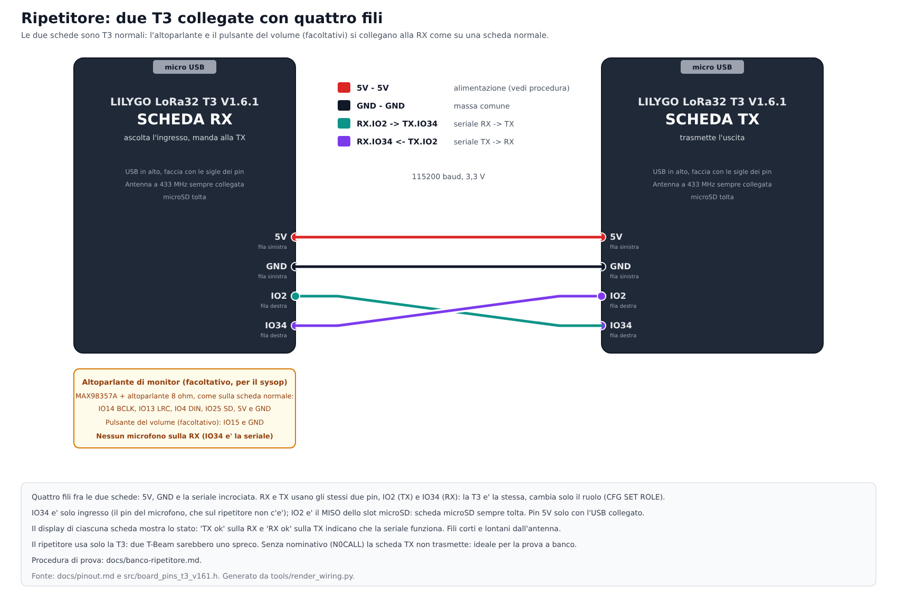

# Il ripetitore: riepilogo (12/11/2026)

Pagina di riepilogo di tutto quello che il ripetitore fa e di come si collega. I dettagli e le decisioni sono nei documenti collegati. **Stato: tutta la logica è provata sul PC e il firmware compila (GitHub Actions); nulla è ancora stato provato sulle schede.** La prima prova è a banco: [banco-ripetitore.md](banco-ripetitore.md).

## Come è fatto
*Il collegamento a Internet (nodo su Wi-Fi) invece funziona anche su T-Beam: [studio-nodo-internet.md](studio-nodo-internet.md).*

- **Due T3 V1.6.1 normali, già cablate come stazioni** (microfono, altoparlante, pulsanti restano come sono). Due T-Beam sarebbero uno spreco: il ripetitore è solo T3 e il firmware rifiuta il ruolo sulla T-Beam.
- **Scheda RX:** ascolta la frequenza di **ingresso** (quella del profilo), decide cosa ripetere e lo manda alla TX. Non trasmette mai.
- **Scheda TX:** ritrasmette sulla frequenza di **uscita** (`FREQOUT`), ascolta i messaggi quando è libera, manda identificativo, annunci e risposte del sysop.
- **Un solo profilo ripetuto** per ripetitore (di base Standard, SF8/250 kHz), più il Messaggio sulla frequenza di uscita per i messaggi.

## Collegamento: quattro fili
5V, GND e la seriale incrociata (115200 baud, 3,3 V): **RX.IO2 → TX.S_VP (IO36)** e **TX.IO2 → RX.S_VP**. Sono pin che il cablaggio normale non usa, quindi l'altoparlante di monitor e il pulsante del volume si collegano alla RX come su una scheda normale. microSD sempre tolta. Alimentazione e pin sono **da verificare sul banco**. Schema:  ([firmware.md](firmware.md), [pinout.md](pinout.md)).

## Come si configura
Dalla **pagina di configurazione** (quella interna della scheda o il sito con il cavo USB), sezione *Ripetitore*, oppure da seriale. Valgono dal riavvio.

| Cosa | Comando | Note |
|---|---|---|
| Ruolo | `CFG SET ROLE OFF\|RPTRX\|RPTTX` | una scheda in ruolo da ripetitore non ha il menu a bordo: per tornare stazione serve il cavo USB |
| Frequenza di ingresso | `CFG SET FREQ` | quella del profilo, sulla RX |
| Frequenza di uscita | `CFG SET FREQOUT` | sulla TX; è anche la frequenza dei messaggi |
| Nominativo | `CFG SET CALLSIGN` | con N0CALL la TX non trasmette (ideale a banco) |
| Altoparlante di monitor | `CFG SET MONITOR ON` | solo RX |
| Identificativo ogni N minuti | `CFG SET IDINT 1..10` | di base 10 |
| Identificativo in Morse FM | `CFG SET IDMORSE ON\|OFF` | di base acceso |
| Sysop | `CFG SET SYSOP`, `SYSOPKEY`, `SYSOPMODE` | vedi sotto |

## Cosa fa
| Funzione | Come | Dettagli |
|---|---|---|
| **Voce** | la RX ripete i pacchetti del modo del profilo (e il testo) con il flag `RELAYED`, senza ripetere due volte lo stesso pacchetto né un pacchetto già ripetuto; sessione massima 35 s; la TX li trasmette con 80 ms fra uno e l'altro | [studio-ripetitore.md](studio-ripetitore.md) |
| **Testo** (modo 7) | ripetuto come un pacchetto qualsiasi, fuori dalla durata del turno vocale | [protocollo.md](protocollo.md) |
| **Messaggi vocali** (profilo Messaggio, SF12/125 kHz) | la TX li riceve quando è libera, ricostruisce i pacchetti persi con la parità, li tiene (massimo 15 s di voce, 3 messaggi, 30 minuti) e li ritrasmette dopo 20 s di silenzio vocale con una sessione nuova. La voce ha sempre la precedenza: interrompe il messaggio, che riparte da capo | [studio-ripetitore.md](studio-ripetitore.md), [modo-messaggio.md](modo-messaggio.md) |
| **Annuncio di occupato** (modo 6) | prima di ritrasmettere un messaggio la TX manda, con i parametri della voce, il tempo previsto; le stazioni lo mostrano ("RIP. OCCUPATO") e **non bloccano il PTT**. A fine servizio un annuncio a zero | [protocollo.md](protocollo.md) |
| **Identificativo** | ogni 1-10 minuti un testo con il nominativo del ripetitore (seq 1): le stazioni lo mostrano come "Ultimo IR5XXX ID" con il segnale, **senza bip** e senza casella. Una voce passata dal ripetitore si legge "Ultimo IZ5FSN via RPT" | [protocollo.md](protocollo.md), [display.md](display.md) |
| **Morse in FM** | dopo il testo, il nominativo in Morse con un tono in FM stretta (15 wpm, 700 Hz, ±2,5 kHz): per chi non ha le schede LoRa. La voce lo interrompe | [studio-identificativo-fm.md](studio-identificativo-fm.md) |
| **Comandi del sysop** (modo 5) | STATO, SPEGNI (anche a tempo), RIACCENDI, RIAVVIA, IDENTIFICA, POTENZA (salvata in memoria); firmati con HMAC-SHA256 e contatore anti-ripetizione; la TX risponde firmata. Sulla scheda del sysop il **modo Sysop** mette nel menu "Comandi Sysop" al posto di "Invia testo" | [protocollo.md](protocollo.md), [studio-ripetitore.md](studio-ripetitore.md) |
| **Sicurezza** | una trasmissione continua oltre 60 s di voce (180 s di messaggio) spegne la TX per 5 minuti | [studio-ripetitore.md](studio-ripetitore.md) |
| **Monitor audio** | la RX fa ascoltare la voce che riceve all'altoparlante (per il sysop in postazione); i display di RX e TX mostrano lo stato del collegamento e i contatori | [firmware.md](firmware.md) |

## Cosa non è provato, cosa manca
- **Tutto è provato solo sul PC** (suite di test, pagine web) e compilato dalla CI. Mai in aria, mai su due schede collegate.
- **Da verificare sul banco:** i pin della seriale (IO2 e S_VP/IO36) e l'alimentazione a quattro fili; il cambio dei parametri radio fra voce e messaggi; il passaggio LoRa → FSK → LoRa del Morse; i valori del Morse (tono, deviazione, velocità, salita) con il firmware di prova `CFG RADIOTEST`.
- **Limiti noti:** le stazioni LoRa non vedono il Morse in FM (il controllo del canale non rileva FSK); la risposta del sysop si sente solo con il profilo del ripetitore; il ripetitore non risponde ai comandi con firma sbagliata (voluto); un solo profilo ripetuto.
- Le questioni legali e di autorizzazione del ripetitore sono dell'operatore e non sono trattate qui.

## Dove leggere
[banco-ripetitore.md](banco-ripetitore.md) (prova a banco) · [studio-ripetitore.md](studio-ripetitore.md) (studio e decisioni) · [studio-identificativo-fm.md](studio-identificativo-fm.md) (Morse in FM) · [firmware.md](firmware.md) (comandi e collegamenti) · [protocollo.md](protocollo.md) (modi 5, 6, 7) · [pinout.md](pinout.md) (pin e schemi).
